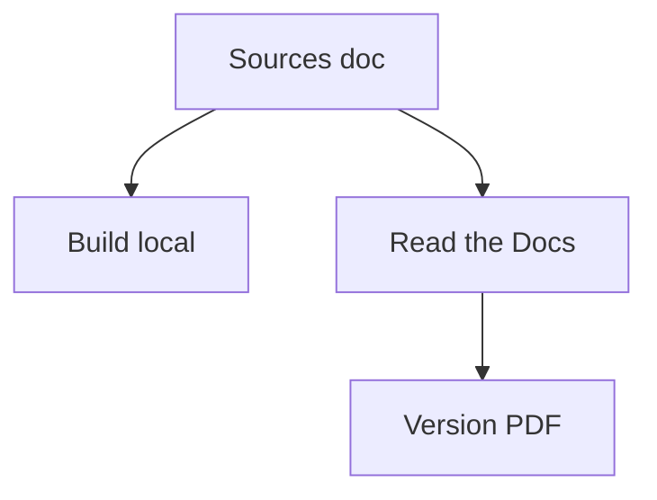

# canonical/ubuntu-server-documentation

> Sources of the official Ubuntu Server documentation, for system administrators.

## The problem
Knowing how to administer and deploy Ubuntu Server in a documented way.

## What it actually does
Contains the documentation sources, viewable online, buildable locally, or as a PDF via Read the Docs. The README is very short: the content is not described.

## How it is wired


## Trying it
```bash
# Aucune commande documentée dans le README (renvoi vers le build local et Read the Docs)
```

## Cost and gotchas
Free. License not declared in the catalog: to be checked before any reuse of the content.

## What it is not
Not the Ubuntu system itself, nor a tool: only the documentation. The README says nothing about the structure.

## Alternatives
None named in the README.

## For you
Ignore: read it online if needed, nothing to adopt or clone for a data / MLOps profile.
