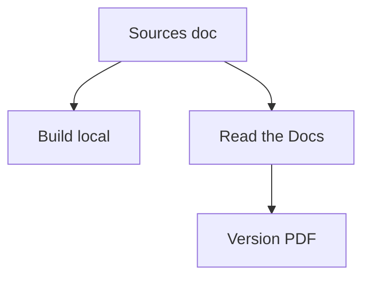

# canonical/ubuntu-server-documentation

> Sources de la documentation officielle d'Ubuntu Server, pour administrateurs système.

## Le problème
Savoir comment administrer et déployer Ubuntu Server de façon documentée.

## Ce que ça fait vraiment
Contient les sources de la documentation, consultable en ligne, à construire en local, ou en PDF via Read the Docs. Le README est très court : le contenu n'est pas décrit.

## Comment c'est branché


## Essayer
```bash
# Aucune commande documentée dans le README (renvoi vers le build local et Read the Docs)
```

## Coût et pièges
Gratuit. Licence non déclarée dans le catalogue : à vérifier avant toute réutilisation du contenu.

## Ce que ce n'est pas
Pas le système Ubuntu lui-même, ni un outil : uniquement la documentation. Le README ne dit rien de la structure.

## Alternatives
Aucune nommée dans le README.

## Pour toi
Ignorer : à lire en ligne au besoin, rien à adopter ni à cloner pour un profil data / MLOps.

