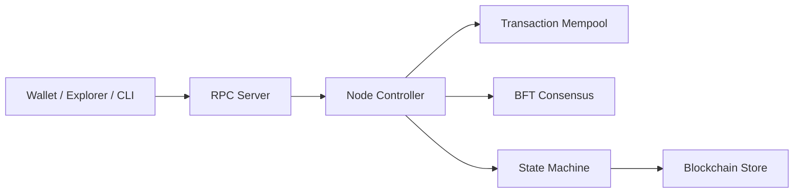

# canopy-network/canopy

> Go implementation of a recursive blockchain node compatible with Ethereum RPC, for chain developers.

## The problem
Launching new blockchains that bootstrap one another, while remaining compatible with Ethereum tooling (MetaMask, explorers).

## What it actually does
A proof-of-stake node made of a central controller, a state machine (accounts, staking, governance, DEX), BFT consensus, an encrypted peer-to-peer network and indexed storage. The node exposes an RPC server, including a `/v1/eth` entry point treated as a custom Ethereum RPC. The repository also contains a wallet, an explorer, a CLI, an offline signer and a plugin SDK.

## How it is wired


## Trying it
```bash
make build/canopy-full
canopy start
make docker/build
make docker/up-fast
make docker/logs
make test
```

## Cost and gotchas
Free. The repository dates from October 2024, making it a young project, and the architecture description specifies that components that were not sampled are represented cautiously. Any real use puts money at stake: the README says nothing about an audit.

## What it is not
It is not a data or AI tool. The README documents neither performance nor a security audit.

## Alternatives
The README names no alternative; it only compares compatibility with Ethereum tools.

## For you
Ignore: blockchain infrastructure unrelated to data/AI/MLOps, young and unaudited according to the README.
