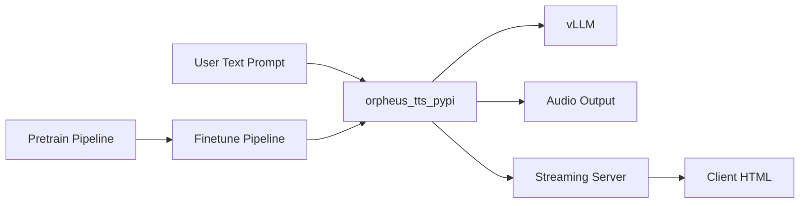

# canopyai/Orpheus-TTS

> Open source speech synthesis model based on Llama-3B, with streaming and voice cloning.

## The problem
Open source TTS often sounds robotic, while the best expressive renderings are closed.

## What it actually does
Finetuned 3B model (named voices: tara, leah…) and a model pre-trained on 100k+ hours of English.
Emotion tags, zero-shot cloning via text-audio pairs in the prompt, ~200 ms streaming.
`orpheus-speech` package relying on vLLM; Transformers-style finetuning and pre-training scripts.
Multilingual family in research release; GPU-free options (llama.cpp) and audio watermarking.

## How it is wired


## Trying it
```bash
git clone https://github.com/canopyai/Orpheus-TTS.git
cd Orpheus-TTS && pip install orpheus-speech
pip install transformers datasets wandb trl flash_attn torch
accelerate launch train.py
```

## Cost and gotchas
GPU needed for vLLM; vLLM version must be pinned (0.7.3) because of a bug.
Known glitch of skipped frames in streaming; the cloning Colab needs fixing.

## What it is not
Not multilingual in production: languages other than English are in research.
Not a free hosted service (Baseten is paid).

## Alternatives
- Baseten: managed deployment recommended by the authors.

## For you
Watch: good-quality open, finetunable TTS, useful for home-made voice assistants, still a bit unstable.
