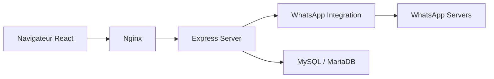

# canove/whaticket-community

> Open source version of a WhatsApp ticketing system: several agents reply from a single number.

## The problem
A support team that receives its customers on WhatsApp cannot share a single number among several agents.

## What it actually does
Each conversation becomes a ticket (pending, open, resolved) assigned to an agent, with queues, quick replies, media, contacts and a dashboard. Node.js/TypeScript/Express/Sequelize backend on MySQL or MariaDB, React + Material UI frontend, WebSockets. The WhatsApp provider is pluggable: `whatsapp-web.js` (Puppeteer) or `whaileys` (WebSocket). Redis optional.

## How it is wired


## Trying it
```bash
git clone https://github.com/canove/whaticket.git
cd whaticket
cp .env.example .env
docker-compose up -d --build
docker-compose exec backend npx sequelize db:seed:all
```

## Cost and gotchas
Passwords and JWT secrets must be changed; default credentials are `admin@whaticket.com` / `admin`. Node 14 required (old). The README states that unofficial clients can get the number blocked.

## What it is not
Not the official WhatsApp Cloud API, which is reserved for the paid offering. The repository is in maintenance, with dated dependencies.

## Alternatives
- Whaticket (commercial offering): official API, chatbots and other channels, from US$49/month.

## For you
Ignore: unrelated to your work and risk of the number being blocked by WhatsApp.
