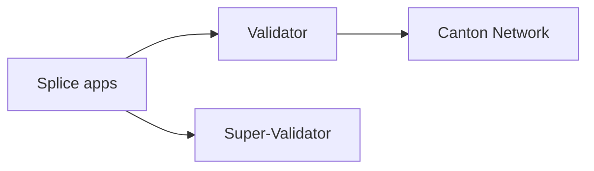

# canton-network/splice

> Applications for operating Validators and Super-Validators on the Canton Network.

## The problem
Operating a validator node on the Canton Network requires dedicated applications.

## What it actually does
The README is only a few lines long and points to the DEVELOPMENT guide, TESTING.md, TROUBLESHOOTING.md and CONTRIBUTING, and mentions an AI policy (AI_POLICY.md). How it works is not documented here.

## How it is wired

## Trying it
No documented command; see DEVELOPMENT.

## Cost and gotchas
Free; 1,019 open issues, installation not described here.

## What it is not
Not a general-purpose tool: specific to the Canton Network.

## Alternatives
No alternative named in the README.

## For you
Ignore: blockchain infrastructure unrelated to data/AI.
