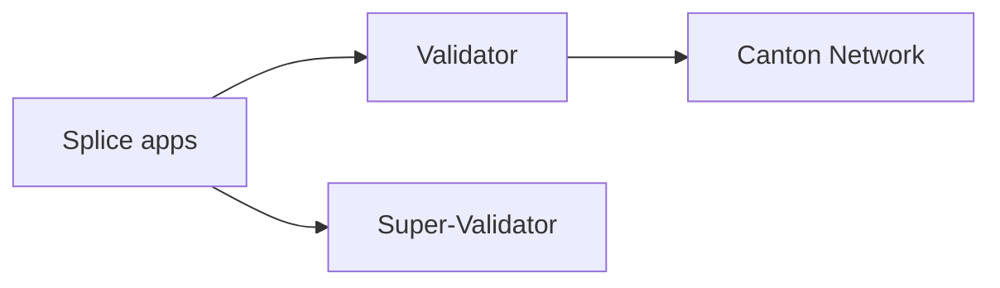

# canton-network/splice

> Applications pour exploiter des Validators et Super-Validators sur le Canton Network.

## Le problème
Opérer un noeud validateur sur le Canton Network demande des applications dédiées.

## Ce que ça fait vraiment
Le README tient en quelques lignes et renvoie au guide DEVELOPMENT, à TESTING.md, TROUBLESHOOTING.md et CONTRIBUTING, et mentionne une politique IA (AI_POLICY.md). Le fonctionnement n'est pas documenté ici.

## Comment c'est branché

## Essayer
Aucune commande documentée ; voir DEVELOPMENT.

## Coût et pièges
Gratuit ; 1 019 issues ouvertes, installation non décrite ici.

## Ce que ce n'est pas
Pas un outil général : spécifique au Canton Network.

## Alternatives
Aucune alternative nommée dans le README.

## Pour toi
À ignorer : infrastructure blockchain sans lien avec data/IA.

