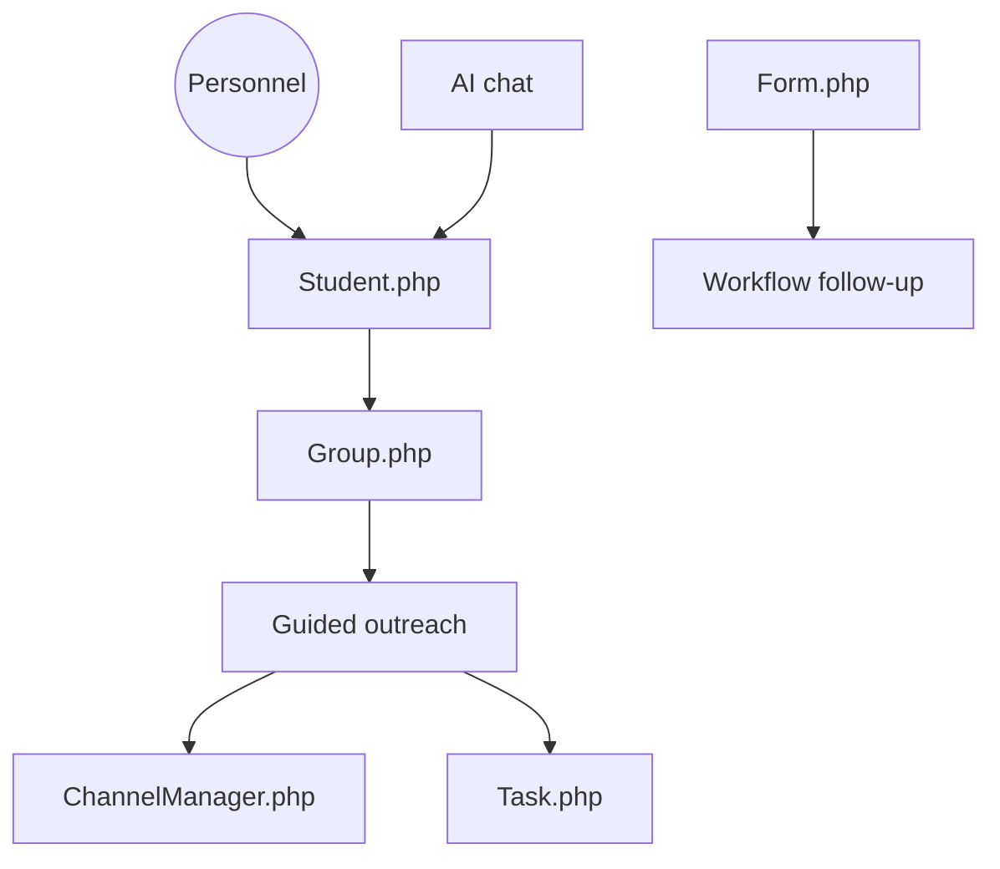

# canyongbs/advisingapp

> Student relationship platform for universities: messages, groups, tasks and AI chat, by Canyon GBS.

## The problem
University staff scatter student records, messages and follow-ups across several tools, with no overall view of each student.

## What it actually does
Student and prospect records, dynamic groups, text and email outreach campaigns, tasks, forms and applications that trigger follow-ups. An AI chat answers from approved content (Azure OpenAI integration documented). Links with campus systems are described in the README, not verified in the code.

## How it is wired
Diagram based on the code diagram.

## Trying it
No command in the README: it points to a local installation guide (Local Setup) that is not reproduced.

## Cost and gotchas
PHP stack (Laravel, Livewire, Filament) to host, with third-party services (SMS, email, Azure OpenAI). The license is the Elastic License 2.0: code is visible but not free, with limits on offering it as a managed service. A paid SaaS version exists.

## What it is not
Not free software in the strict sense. Not a plug-and-play product: contributions are subject to approval by the product team.

## Alternatives
No alternative named in the README.

## For you
Ignore: a business tool for higher education, unrelated to data / AI work, and under a restrictive license.
