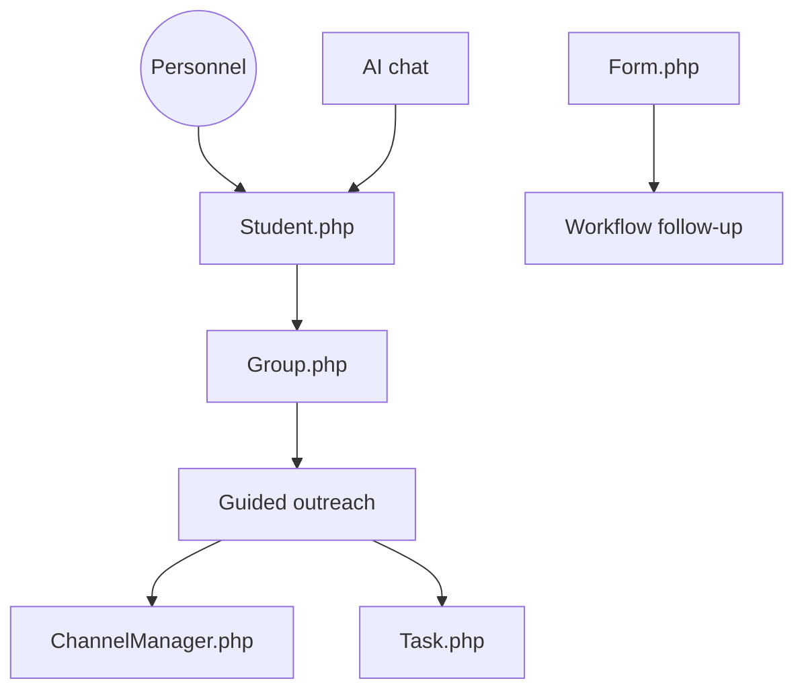

# canyongbs/advisingapp

> Plateforme de relation étudiante pour universités : messages, groupes, tâches et chat IA, par Canyon GBS.

## Le problème
Le personnel d'une université dispersse dossiers étudiants, messages et relances dans plusieurs outils, sans vue d'ensemble de chaque étudiant.

## Ce que ça fait vraiment
Fiches étudiants et prospects, groupes dynamiques, campagnes d'envoi par texto et email, tâches, formulaires et candidatures qui déclenchent des suivis. Un chat IA répond à partir de contenus approuvés (intégration Azure OpenAI documentée). Les liens avec les systèmes du campus sont décrits dans le README, pas vérifiés dans le code.

## Comment c'est branché
Schéma d'après le diagramme du code.

## Essayer
Aucune commande dans le README : renvoi vers un guide d'installation locale (Local Setup) non reproduit.

## Coût et pièges
Pile PHP (Laravel, Livewire, Filament) à héberger, avec des services tiers (SMS, email, Azure OpenAI). La licence est l'Elastic License 2.0 : code visible, mais pas libre, avec limites sur l'offre en service géré. Une version SaaS payante existe.

## Ce que ce n'est pas
Pas un logiciel libre au sens strict. Pas un produit prêt à brancher : les contributions sont soumises à l'approbation de l'équipe produit.

## Alternatives
Aucune alternative nommée dans le README.

## Pour toi
Ignorer : outil métier pour l'enseignement supérieur, sans lien avec le travail data / IA, et sous licence restrictive.

