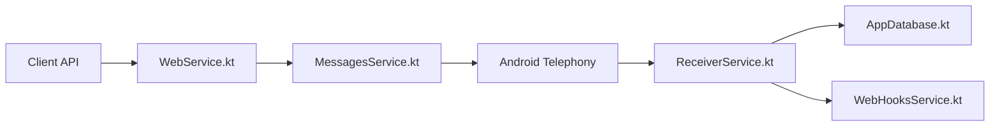

# capcom6/android-sms-gateway

> Android application that turns a phone into an API-driven SMS gateway.

## The problem
Sending SMS from an application usually goes through a paid provider; here, a phone and its SIM card are enough.

## What it actually does
The app exposes a local server (port 8080) or connects to a cloud server. It sends and receives SMS, MMS and data SMS, with scheduling, rate limiting, multi-SIM, end-to-end encryption and webhooks. The README advises against batch sending because of carrier limits.

## How it is wired


## Trying it
```bash
curl -X POST -u <username>:<password> \
  -H "Content-Type: application/json" \
  -d '{ "textMessage": { "text": "Hello, doctors!" }, "phoneNumbers": ["+19162255887"] }' \
  http://<device_local_ip>:8080/message
```

## Cost and gotchas
Free, but SMS are billed by your plan. Cloud mode goes through the project's server (`api.sms-gate.app`); a private server is possible. Building requires a Firebase file and a keystore.

## What it is not
Not a bulk sending service. Installing outside the Play Store requires allowing unknown sources.

## Alternatives
No alternative named in the README.

## For you
Ignore: useful for SMS alerts from a pipeline, but a dedicated provider remains more reliable in production.
