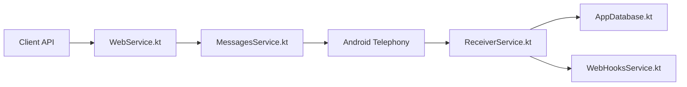

# capcom6/android-sms-gateway

> Application Android qui transforme un téléphone en passerelle SMS pilotable par API.

## Le problème
Envoyer des SMS depuis une application passe d'ordinaire par un fournisseur payant ; ici, un téléphone et sa carte SIM suffisent.

## Ce que ça fait vraiment
L'app expose un serveur local (port 8080) ou se connecte à un serveur cloud. Elle envoie et reçoit SMS, MMS et SMS de données, avec planification, limitation de débit, multi-SIM, chiffrement de bout en bout et webhooks. Le README déconseille l'envoi par lots à cause des limites des opérateurs.

## Comment c'est branché


## Essayer
```bash
curl -X POST -u <username>:<password> \
  -H "Content-Type: application/json" \
  -d '{ "textMessage": { "text": "Hello, doctors!" }, "phoneNumbers": ["+19162255887"] }' \
  http://<device_local_ip>:8080/message
```

## Coût et pièges
Gratuit, mais les SMS sont facturés par ton forfait. Le mode cloud passe par le serveur du projet (`api.sms-gate.app`) ; un serveur privé est possible. Compiler exige un fichier Firebase et un keystore.

## Ce que ce n'est pas
Pas un service d'envoi en masse. L'installation hors Play Store exige d'autoriser les sources inconnues.

## Alternatives
Aucune alternative nommée dans le README.

## Pour toi
À ignorer : utile pour des alertes SMS d'un pipeline, mais un fournisseur dédié reste plus fiable en production.

