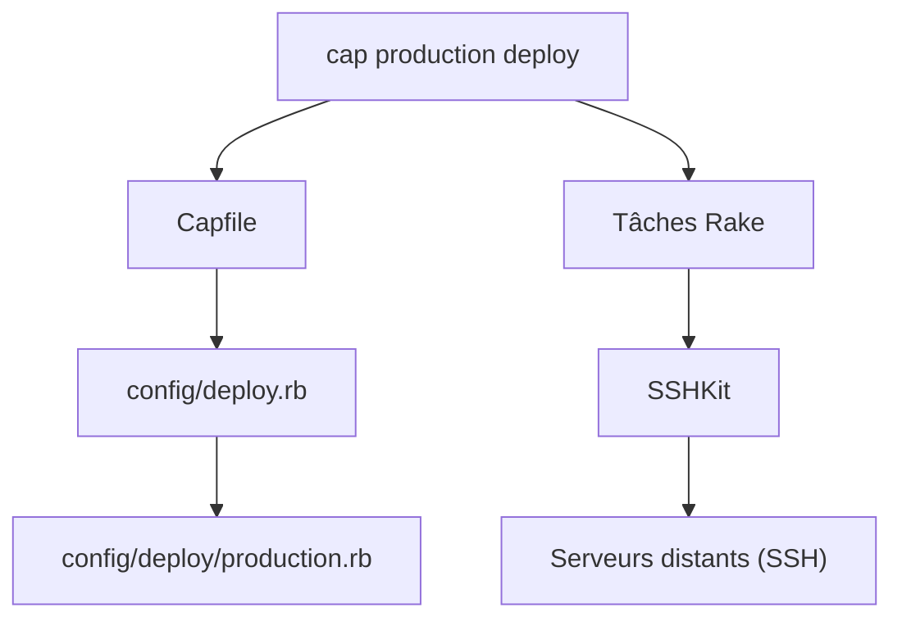

# capistrano/capistrano

> Ruby tool for automated deployment over SSH and Rake tasks, for any type of project.

## The problem
Manual SSH deployments are neither repeatable nor configurable per environment.

## What it actually does
The `cap` command connects to servers over SSH and runs the deployment steps defined as Rake tasks. Standard deployment conventions, multiple environments (staging, production), parallel execution, server roles. Built on SSHKit. Does not provision servers and cannot launch the application by itself.

## How it is wired


## Trying it
```sh
bundle install
bundle exec cap install
bundle exec cap staging deploy
bundle exec cap production deploy --dry-run
```

## Cost and gotchas
Free. Requires passwordless SSH keys, Ruby 2.5+ locally and the source manager binaries on the servers. The README notes that `sudo` and interactive sessions complicate usage. The `prerequis` field above should be read as Ruby, outside the imposed lists.

## What it is not
Not a provisioning tool, nor a containers or Kubernetes tool. Does not start your application without tasks that you write yourself.

## Alternatives
The linked repositories cited are `capistrano/sshkit`, `capistrano/rails` and `mattbrictson/airbrussh`, components rather than substitutes.

## For you
Ignore: Ruby SSH deployment, far from the container and Kubernetes practices of an MLOps profile, unless you inherit a Rails application.
