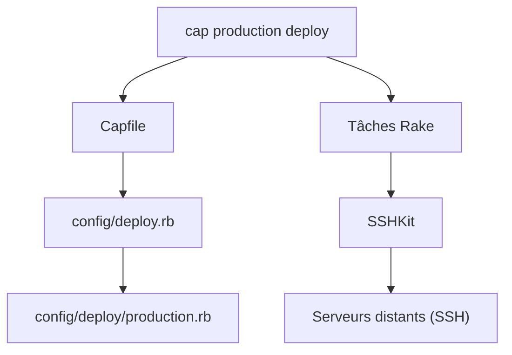

# capistrano/capistrano

> Outil Ruby de déploiement automatisé par SSH et tâches Rake, pour tout type de projet.

## Le problème
Les déploiements manuels par SSH ne sont ni répétables ni paramétrables par environnement.

## Ce que ça fait vraiment
La commande `cap` se connecte aux serveurs en SSH et exécute les étapes de déploiement définies en tâches Rake. Conventions de déploiement standard, environnements multiples (staging, production), exécution en parallèle, rôles de serveurs. S'appuie sur SSHKit. Ne provisionne pas les serveurs et ne sait pas lancer l'application seul.

## Comment c'est branché


## Essayer
```sh
bundle install
bundle exec cap install
bundle exec cap staging deploy
bundle exec cap production deploy --dry-run
```

## Coût et pièges
Gratuit. Exige des clés SSH sans mot de passe, Ruby 2.5+ en local et les binaires du gestionnaire de source sur les serveurs. Le README note que `sudo` et les sessions interactives compliquent l'usage. Le champ `prerequis` ci-dessus est à lire comme Ruby, hors des listes imposées.

## Ce que ce n'est pas
Pas un outil de provisioning, ni de conteneurs ou Kubernetes. Ne démarre pas votre application sans tâches écrites par vous.

## Alternatives
Les dépôts liés cités sont `capistrano/sshkit`, `capistrano/rails` et `mattbrictson/airbrussh`, des composants plutôt que des substituts.

## Pour toi
À ignorer : déploiement par SSH en Ruby, éloigné des pratiques conteneur et Kubernetes d'un profil MLOps, sauf si tu hérites d'une application Rails.

