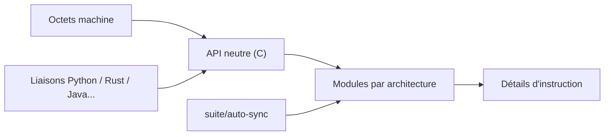

# capstone-engine/capstone

> Multi-architecture disassembly engine, in C, for binary analysis and reverse engineering.

## The problem
Reading machine instructions from many architectures through a single API, including in malicious code.

## What it actually does
Turns bytes into instructions for ARM, AArch64, x86 (16/32/64), MIPS, PPC, RISC-V, BPF, WebAssembly and many others. Provides the details of each instruction and its semantics (registers read/written). Written in pure C, thread-safe, embeddable in firmware or a kernel; bindings exist for Python, Rust, Java, Go and others.

## How it is wired

## Trying it
No command in the README: it points to `BUILDING.md`, `docs/README` and `docs/ARCHITECTURE.md`.

## Cost and gotchas
Free. The catalog detects no license, whereas the README announces the BSD license and asks to include `LICENSE.TXT`: check before redistributing.

## What it is not
Not an interactive disassembler: it is a library to integrate. Not a data analysis tool.

## Alternatives
None cited in the README.

## For you
Watch: useful if you analyze binaries or model security, otherwise useless for everyday data/AI.
