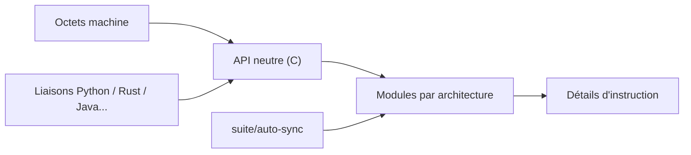

# capstone-engine/capstone

> Moteur de désassemblage multi-architectures, en C, pour l'analyse binaire et la rétro-ingénierie.

## Le problème
Lire des instructions machine de nombreuses architectures avec une seule API, y compris dans du code malveillant.

## Ce que ça fait vraiment
Transforme des octets en instructions pour ARM, AArch64, x86 (16/32/64), MIPS, PPC, RISC-V, BPF, WebAssembly et bien d'autres. Fournit le détail de chaque instruction et sa sémantique (registres lus/écrits). Écrit en C pur, thread-safe, intégrable dans un firmware ou un noyau ; des liaisons existent pour Python, Rust, Java, Go et d'autres.

## Comment c'est branché

## Essayer
Aucune commande dans le README : il renvoie à `BUILDING.md`, `docs/README` et `docs/ARCHITECTURE.md`.

## Coût et pièges
Gratuit. Le catalogue ne détecte aucune licence, alors que le README annonce la licence BSD et demande de joindre `LICENSE.TXT` : à vérifier avant redistribution.

## Ce que ce n'est pas
Pas un désassembleur interactif : c'est une bibliothèque à intégrer. Pas un outil d'analyse de données.

## Alternatives
Aucune citée dans le README.

## Pour toi
Surveiller : utile si tu analyses des binaires ou la sécurité de modèles, sinon inutile pour du data/IA courant.

