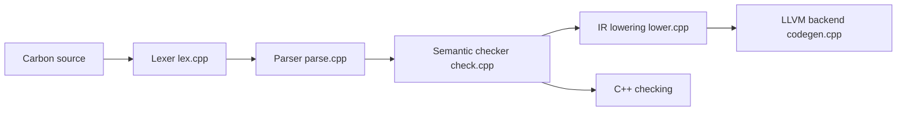

# carbon-language/carbon-lang

> Experimental language designed as a successor to C++, with two-way interoperability with C++.

## The problem
C++ is hard to improve because of its technical debt; migrating to another language is expensive.

## What it actually does
A language project with a toolchain under development: lexer, parser, semantic checking, code generation via LLVM, linking. Checked generics, C++ interop, formatter and language server. The README states that Carbon is not ready for use; only experimental nightly builds exist.

## How it is wired


## Trying it
```bash
./carbon_toolchain-${VERSION}/bin/carbon compile --output=forty_two.o forty_two.carbon
./carbon_toolchain-${VERSION}/bin/carbon link --output=forty_two forty_two.o
./scripts/run_bazelisk.py run //toolchain -- help
```

## Cost and gotchas
Free. Nightly builds only, on limited platforms (recent Ubuntu). The README asks users to avoid filing many bugs. License present but not identified (Apache-2.0 with LLVM exception according to the README header).

## What it is not
Not usable in production, no stable ABI and no perfect compatibility between versions, and the README advises using Go, Swift, Kotlin or Rust if possible.

## Alternatives
Go, Swift, Kotlin, Rust: cited in the README as languages to prefer when migrating from C++ is not the constraint.

## For you
Ignore: experimental language with no ecosystem, irrelevant to AI or MLOps.
