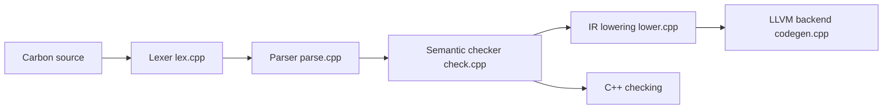

# carbon-language/carbon-lang

> Langage expérimental conçu comme successeur de C++, avec interopérabilité bidirectionnelle avec C++.

## Le problème
C++ s'améliore difficilement à cause de sa dette technique ; migrer vers un autre langage coûte cher.

## Ce que ça fait vraiment
Projet de langage avec chaîne d'outils en développement : lexeur, parseur, vérification sémantique, génération de code via LLVM, lien. Génériques vérifiés, interop C++, formateur et serveur de langage. Le README précise que Carbon n'est pas prêt à l'emploi ; seules des versions nocturnes expérimentales existent.

## Comment c'est branché


## Essayer
```bash
./carbon_toolchain-${VERSION}/bin/carbon compile --output=forty_two.o forty_two.carbon
./carbon_toolchain-${VERSION}/bin/carbon link --output=forty_two forty_two.o
./scripts/run_bazelisk.py run //toolchain -- help
```

## Coût et pièges
Gratuit. Versions nocturnes seulement, sur plateformes limitées (Ubuntu récent). Le README demande d'éviter de déposer beaucoup de bugs. Licence présente mais non identifiée (Apache-2.0 avec exception LLVM d'après l'en-tête du README).

## Ce que ce n'est pas
Pas utilisable en production, pas de ABI stable ni de compatibilité parfaite entre versions, et le README conseille d'utiliser Go, Swift, Kotlin ou Rust si c'est possible.

## Alternatives
Go, Swift, Kotlin, Rust : cités dans le README comme langages à préférer quand une migration depuis C++ n'est pas la contrainte.

## Pour toi
À ignorer : langage expérimental sans écosystème, sans pertinence pour de l'IA ou du MLOps.

