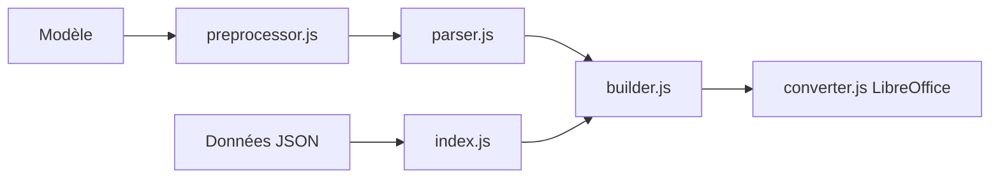

# carboneio/carbone

> Node.js report generation engine: JSON injected into Office or LibreOffice templates.

## The problem
Producing documents (invoices, reports) from JSON data without coding the layout.

## What it actually does
You write a template in LibreOffice or Office with `{d.firstname}` markers; Carbone injects the JSON and renders the document (docx, odt, xlsx, html, pptx...). If LibreOffice is installed, it converts to PDF via workers managed with a queue and three retries. Number and date formats, translation, conditions. Server side only.

## How it is wired


## Trying it
```bash
npm install carbone
```
```javascript
carbone.render('./node_modules/carbone/examples/simple.odt', data, function(err, result){ });
```

## Cost and gotchas
Free in the community edition; LibreOffice required for PDF (manual installation on Ubuntu). License present but not identified by GitHub: to be checked, especially as the README mentions several editions.

## What it is not
Not a native PDF generator. Does not run in the browser.

## Alternatives
No alternative named in the README.

## For you
Worth watching: useful to automate reports from data, but read the license before any commercial use.
