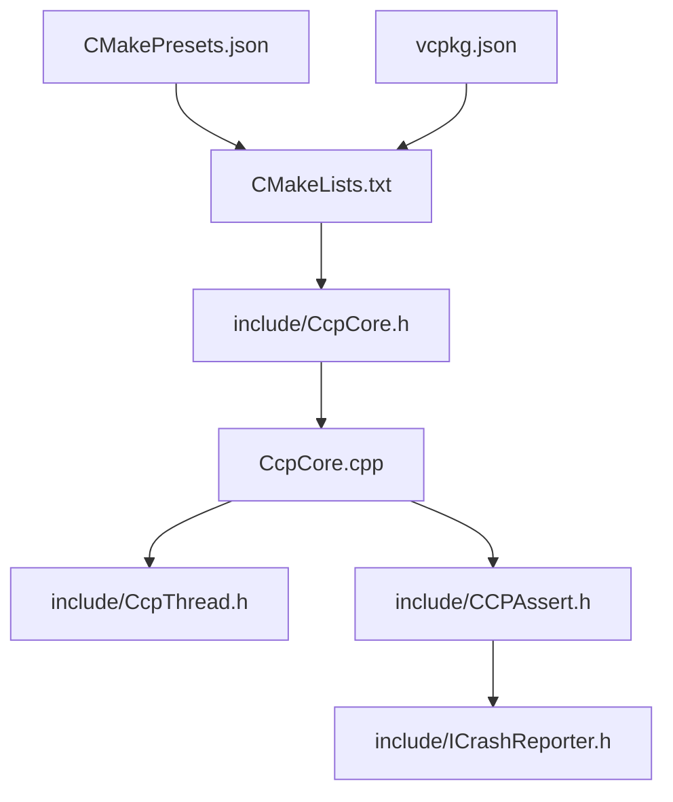

# carbonengine/core

> C++ library of low-level cross-platform abstractions for system calls.

## The problem
Portable C++ code needs common layers for threads, files, memory and diagnostics.

## What it actually does
Threads, mutexes, semaphores, processes, time, files, string conversion, memory allocation and tracking, assertions, logs, call stacks, a crash reporter interface and telemetry. CMake build, dependencies via vcpkg, TeamCity CI.

## How it is wired

## Trying it
Build through the `CMakeLists` at the root; documentation with the CMake option `BUILD_DOCUMENTATION`. No detailed command in the README.

## Cost and gotchas
Documentation generated with Doxygen 1.12.0 minimum, on Windows or macOS. Depends on vcpkg.

## What it is not
Not a full game engine, despite the organization's name: only the low-level foundation.

## Alternatives
No alternative named.

## For you
Ignore: system C++ library, unrelated to data/AI.
