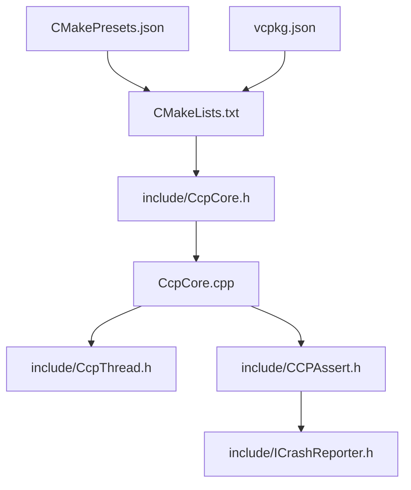

# carbonengine/core

> Bibliothèque C++ d'abstractions bas niveau multiplateformes pour appels système.

## Le problème
Du code C++ portable a besoin de couches communes pour threads, fichiers, mémoire et diagnostics.

## Ce que ça fait vraiment
Threads, mutex, sémaphores, processus, temps, fichiers, conversion de chaînes, allocation et suivi mémoire, assertions, journaux, piles d'appels, interface de rapport de plantage et télémétrie. Construction CMake, dépendances par vcpkg, CI TeamCity.

## Comment c'est branché

## Essayer
Construction par le `CMakeLists` à la racine ; documentation avec l'option CMake `BUILD_DOCUMENTATION`. Aucune commande détaillée dans le README.

## Coût et pièges
Documentation générée avec Doxygen 1.12.0 minimum, sous Windows ou macOS. Dépend de vcpkg.

## Ce que ce n'est pas
Pas un moteur de jeu complet, malgré le nom de l'organisation : seulement le socle bas niveau.

## Alternatives
Aucune alternative nommée.

## Pour toi
À ignorer : bibliothèque C++ système, sans rapport avec data/IA.

