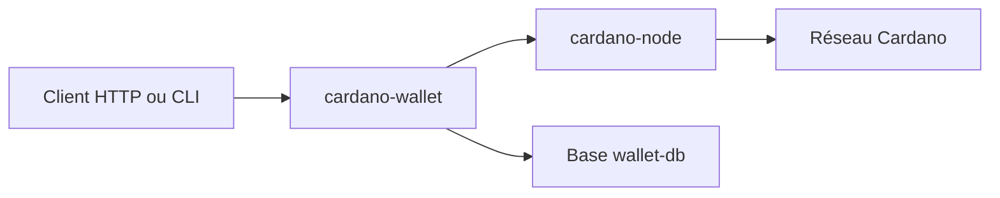

# cardano-foundation/cardano-wallet

> Cardano wallet HTTP server and CLI, for applications that handle ADA.

## The problem
Sending and receiving ADA programmatically requires a wallet accessible through an API.

## What it actually does
- `cardano-wallet` executable: HTTP server and CLI.
- Connects to a running `cardano-node` to read the chain and send transactions.
- Launched through Docker (`run.sh start`, `stop`, `logs`, `sync`) or Nix.
- Mainnet: 200 GB of disk and 24 GB of RAM for the node; a Mithril snapshot is possible.
- Maintenance-only mode since April 1, 2025: fixes, no new features.

## How it is wired


## Trying it
```bash
cd run/private/docker
WALLET_PORT=8090 ./run.sh start
curl http://localhost:8090/v2/network/information | jq
./run.sh logs
./run.sh stop
```

## Cost and gotchas
Heavy resources on mainnet. Never expose the wallet port to the Internet. The example `.env` file points to a configuration "copied from a malicious site": do not copy an unknown configuration.

## What it is not
Not a consumer application: the README points to Daedalus. No new features are developed by the Foundation anymore.

## Alternatives
Daedalus (graphical interface built on top of this wallet).

## For you
Ignore: cryptocurrency, outside the data / AI / MLOps scope.
