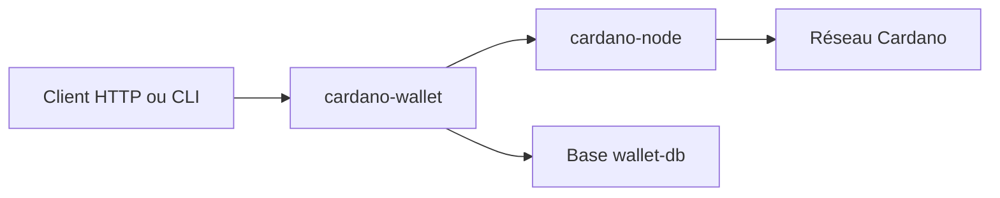

# cardano-foundation/cardano-wallet

> Serveur HTTP et CLI de portefeuille Cardano, pour applications qui gèrent de l'ADA.

## Le problème
Envoyer et recevoir de l'ADA par programme demande un portefeuille accessible par API.

## Ce que ça fait vraiment
- Exécutable `cardano-wallet` : serveur HTTP et CLI.
- Se connecte à un `cardano-node` en cours d'exécution pour lire la chaîne et envoyer des transactions.
- Lancement par Docker (`run.sh start`, `stop`, `logs`, `sync`) ou Nix.
- Mainnet : 200 Go de disque et 24 Go de RAM pour le nœud ; instantané Mithril possible.
- Mode maintenance seule depuis le 1er avril 2025 : correctifs, pas de nouvelles fonctions.

## Comment c'est branché


## Essayer
```bash
cd run/private/docker
WALLET_PORT=8090 ./run.sh start
curl http://localhost:8090/v2/network/information | jq
./run.sh logs
./run.sh stop
```

## Coût et pièges
Ressources lourdes sur mainnet. Ne jamais exposer le port du portefeuille sur Internet. Le fichier `.env` d'exemple pointe vers une configuration « copiée d'un site malveillant » : ne pas copier une configuration inconnue.

## Ce que ce n'est pas
Pas une application grand public : le README renvoie vers Daedalus. Plus de nouvelles fonctions développées par la Fondation.

## Alternatives
Daedalus (interface graphique qui s'appuie sur ce portefeuille).

## Pour toi
À ignorer : cryptomonnaie, hors périmètre data / IA / MLOps.

