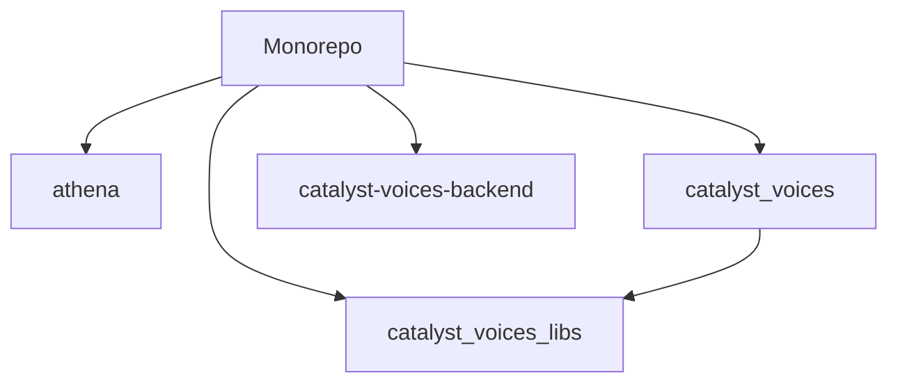

# cardano-foundation/catalyst-voices

> Monorepo of the Catalyst Voices ecosystem: frontend, data gateway and Flutter and Dart packages.

## The problem
A community governance project has several building blocks (interface, backend, libraries) to keep in a single repository.

## What it actually does
Groups four projects: Athena (description not filled in in the README), Catalyst Voices (interface), Catalyst Data Gateway (backend services) and shared Flutter/Dart packages. The README points each project to its own folder; the documentation links are templates to fill in.

## How it is wired


## Trying it
```bash
git clone https://github.com/input-output-hk/catalyst-voices.git
cd catalyst-voices
```

## Cost and gotchas
Free. Flutter and Dart are needed for the frontend, but the README does not name them as prerequisites. Build instructions are in each sub-project.

## What it is not
Not a product documented here: the README is a skeleton and Athena's description is placeholder text to complete.

## Alternatives
No alternative named in the README.

## For you
Ignore: a blockchain governance application with no link to data, AI or MLOps.
