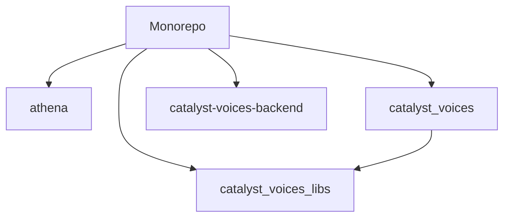

# cardano-foundation/catalyst-voices

> Monorepo de l'écosystème Catalyst Voices : frontend, passerelle de données et paquets Flutter et Dart.

## Le problème
Un projet de gouvernance communautaire a plusieurs briques (interface, backend, bibliothèques) à tenir dans un même dépôt.

## Ce que ça fait vraiment
Regroupe quatre projets : Athena (description non renseignée dans le README), Catalyst Voices (interface), Catalyst Data Gateway (services backend) et des paquets partagés Flutter/Dart. Le README renvoie chaque projet à son propre dossier ; les liens de documentation sont des modèles à remplir.

## Comment c'est branché


## Essayer
```bash
git clone https://github.com/input-output-hk/catalyst-voices.git
cd catalyst-voices
```

## Coût et pièges
Gratuit. Flutter et Dart sont nécessaires pour le frontend, mais le README ne les nomme pas comme prérequis. Les instructions de build sont dans chaque sous-projet.

## Ce que ce n'est pas
Pas un produit documenté ici : le README est un squelette et la description d'Athena est un texte à compléter.

## Alternatives
Aucune alternative nommée dans le README.

## Pour toi
À ignorer : application de gouvernance blockchain sans lien avec la data, l'IA ou le MLOps.

