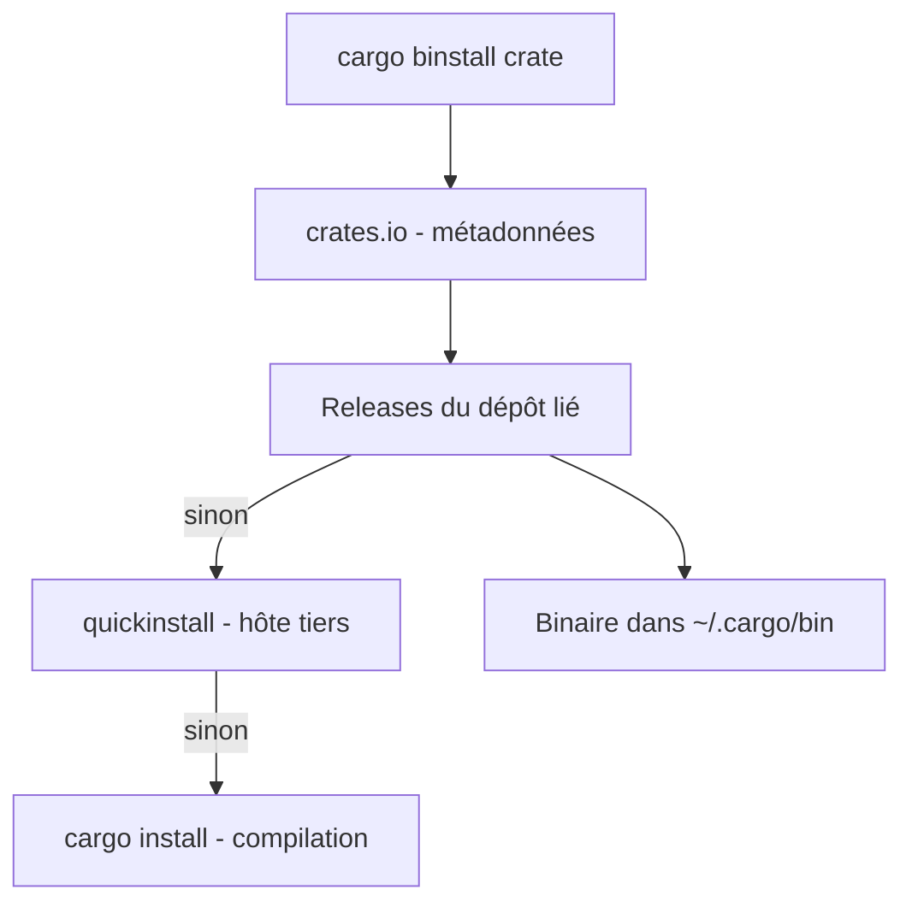

# cargo-bins/cargo-binstall

> Command that installs precompiled Rust binaries instead of compiling them, for Rust developers and CI.

## The problem
`cargo install` compiles everything from source, which takes considerable time on limited machines, and downloading releases by hand is tedious.

## What it actually does
Binstall reads the crate's information from crates.io, looks for release artifacts in the linked repository, then tries the third-party host quickinstall, other targets, and finally `cargo install`. It verifies the crate checksum and enforces HTTPS with TLS 1.2 or higher. Package signing is supported in a limited way (`--only-signed`). Crate authors add metadata in `Cargo.toml`.

## How it is wired
Simplified diagram based on the sheet, no diagram provided.



## Trying it
```bash
curl -L --proto '=https' --tlsv1.2 -sSf https://raw.githubusercontent.com/cargo-bins/cargo-binstall/main/install-from-binstall-release.sh | bash
cargo binstall radio-sx128x@0.14.1-alpha.5
cargo binstall --no-confirm <crate>
```

## Cost and gotchas
Free. Telemetry: with the quickinstall host, the crate name, its version, the target and the agent are sent; disabled with `--disable-telemetry` or `BINSTALL_DISABLE_TELEMETRY=true`. It does not run arbitrary code, but the installed crate may be malicious. GPL-3.0 license.

## What it is not
Not a system package manager nor a security guarantee: few crates are signed. It depends on authors having published binaries.

## Alternatives
- taiki-e/install-action: more features in CI, it relies on Binstall for the rest.
- cargo-update: updates all installed tools.
- cargo-run-bin: project-scoped tools, versions pinned in `Cargo.toml`.

## For you
Worth watching: a real time saver for installing Rust tools in CI or in a container, but only useful if your toolchain uses them; remember to turn telemetry off.
