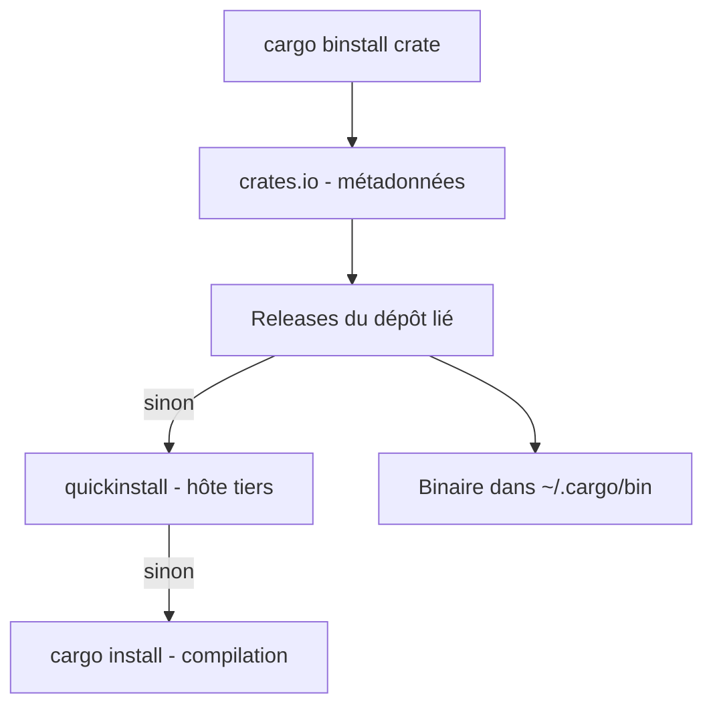

# cargo-bins/cargo-binstall

> Commande qui installe des binaires Rust précompilés au lieu de les compiler, pour développeurs Rust et CI.

## Le problème
`cargo install` compile tout depuis les sources, ce qui prend un temps considérable sur des machines limitées, et télécharger des releases à la main est fastidieux.

## Ce que ça fait vraiment
Binstall lit les informations du crate sur crates.io, cherche les artefacts de release dans le dépôt lié, puis tente l'hôte tiers quickinstall, d'autres cibles, et enfin `cargo install`. Il vérifie la somme de contrôle du crate et impose HTTPS avec TLS 1.2 ou plus. La signature des paquets est supportée de façon limitée (`--only-signed`). Les auteurs de crates ajoutent des métadonnées dans `Cargo.toml`.

## Comment c'est branché
Schéma simplifié d'après la fiche, sans diagramme fourni.



## Essayer
```bash
curl -L --proto '=https' --tlsv1.2 -sSf https://raw.githubusercontent.com/cargo-bins/cargo-binstall/main/install-from-binstall-release.sh | bash
cargo binstall radio-sx128x@0.14.1-alpha.5
cargo binstall --no-confirm <crate>
```

## Coût et pièges
Gratuit. Télémétrie : avec l'hôte quickinstall, le nom du crate, sa version, la cible et l'agent sont envoyés ; désactivation par `--disable-telemetry` ou `BINSTALL_DISABLE_TELEMETRY=true`. Il n'exécute pas de code arbitraire, mais le crate installé peut être malveillant. Licence GPL-3.0.

## Ce que ce n'est pas
Ce n'est pas un gestionnaire de paquets système ni une garantie de sécurité : peu de crates sont signés. Il dépend de la présence de binaires publiés par les auteurs.

## Alternatives
- taiki-e/install-action : plus de fonctions en CI, il s'appuie sur Binstall pour le reste.
- cargo-update : met à jour tous les outils installés.
- cargo-run-bin : outils limités au projet, versions figées dans `Cargo.toml`.

## Pour toi
À surveiller : gain de temps réel pour installer des outils Rust en CI ou en conteneur, mais utile seulement si ta chaîne en utilise ; pense à couper la télémétrie.

