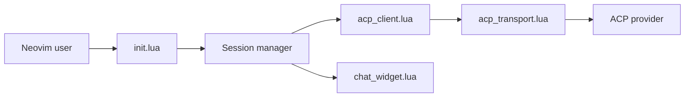

# carlos-algms/agentic.nvim

> Neovim chat interface for any agent compatible with the Agent Client Protocol (Claude, Gemini, Codex and others).

## The problem
Each coding agent has its own CLI; under Neovim, you juggle terminals with no editor context or visual validation of changes.

## What it actually does
Chat sidebar that speaks ACP to the CLI of your choice. Reuses your existing configuration (MCP, skills, subagents) and its authentications with no extra key. Context through files, selections, diagnostics, `@` for files, slash commands, model and provider switching, multiple sessions interchangeable with the terminal, diff preview and tool approval.

## How it is wired


## Trying it
```lua
{
  "carlos-algms/agentic.nvim",
  opts = { provider = "claude-agent-acp" },
}
```
```vim
:checkhealth agentic
```

## Cost and gotchas
Free, but the provider's CLI must be installed manually (pnpm recommended). Neovim ≥ 0.11 required.

## What it is not
Not an agent: the intelligence stays in the ACP provider. The plugin installs no binary, for security reasons.

## Alternatives
- coder/claudecode.nvim: limited to Claude Code through its IDE protocol.

## For you
Adopt if you use several agents under Neovim: provider-neutral, MIT, active.
