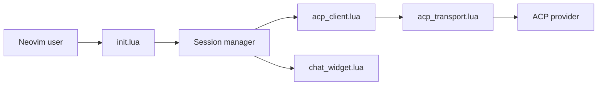

# carlos-algms/agentic.nvim

> Interface de chat Neovim pour tout agent compatible Agent Client Protocol (Claude, Gemini, Codex et autres).

## Le problème
Chaque agent de code a son CLI ; sous Neovim, on jongle entre terminaux sans contexte d'éditeur ni validation visuelle des modifications.

## Ce que ça fait vraiment
Barre latérale de chat qui parle ACP au CLI de ton choix. Reprend ta configuration existante (MCP, skills, sous-agents) et ses authentifications sans clé supplémentaire. Contexte par fichiers, sélections, diagnostics, `@` pour les fichiers, commandes slash, changement de modèle et de fournisseur, sessions multiples interchangeables avec le terminal, aperçu de diff et approbation des outils.

## Comment c'est branché


## Essayer
```lua
{
  "carlos-algms/agentic.nvim",
  opts = { provider = "claude-agent-acp" },
}
```
```vim
:checkhealth agentic
```

## Coût et pièges
Gratuit, mais le CLI du fournisseur doit être installé à la main (pnpm recommandé). Neovim ≥ 0.11 requis.

## Ce que ce n'est pas
Pas un agent : l'intelligence reste dans le fournisseur ACP. Le plugin n'installe aucun binaire pour des raisons de sécurité.

## Alternatives
- coder/claudecode.nvim : limité à Claude Code via son protocole IDE.

## Pour toi
Adopter si tu utilises plusieurs agents sous Neovim : neutre vis-à-vis du fournisseur, MIT, actif.

