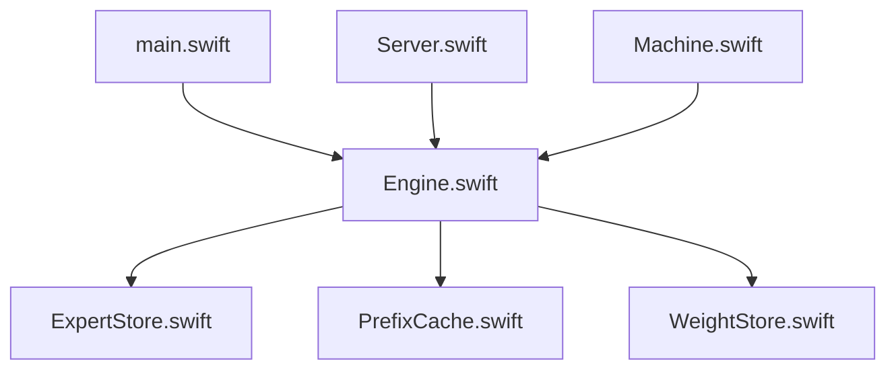

# carloslfu/slotstream

> Local inference engine in Swift for Apple Silicon Macs: a 105 GB model runs with 16 to 64 GB of RAM.

## The problem
A model larger than the Mac's memory saturates RAM at load time, and standard loaders fail.

## What it actually does
Native Swift engine on MLX and Metal. It reads the experts of a mixture-of-experts model from the SSD and keeps the frequent ones in cache. Only one model is maintained: Qwen3.8-Flash-Next 4-bit. Server compatible with Ollama, OpenAI and Anthropic; `launch` starts Claude Code, Codex and others on the local model. Measured: 20.91 to 23.69 tok/s on an M5 Pro 48 GB.

## How it is wired


## Trying it
```bash
curl -fsSL https://raw.githubusercontent.com/carloslfu/slotstream/main/install.sh | sh
slotstream doctor
slotstream run --prompt "Why is the sky blue?"
```

## Cost and gotchas
Free, offline after download. About 110 GB of SSD, macOS 14+, Apple Silicon only. The download can take hours; swap is possible, hence SSD wear.

## What it is not
Not multi-model, and no Linux, Windows or Intel Mac. Not faster than an all-in-RAM engine on 96 GB and more. One generation at a time, no broad quality benchmark.

## Alternatives
The README points to "related projects" without naming them here.

## For you
Keep an eye on it: interesting for trying a large MoE locally on a Mac, but a single model, a single maintainer and a young project.
