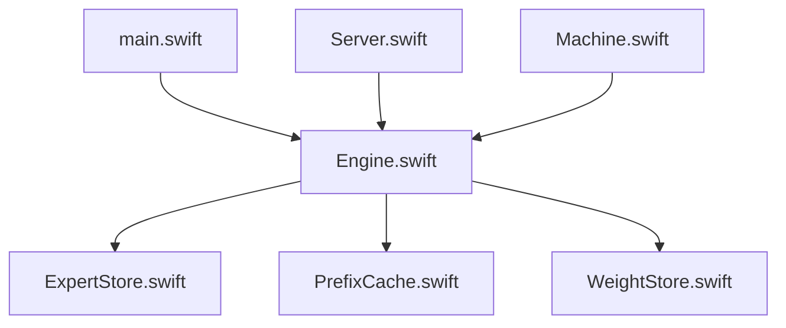

# carloslfu/slotstream

> Moteur d'inférence local en Swift pour Mac Apple Silicon : un modèle de 105 Go tourne avec 16 à 64 Go de RAM.

## Le problème
Un modèle plus gros que la mémoire du Mac sature la RAM au chargement, et les chargeurs standard échouent.

## Ce que ça fait vraiment
Moteur natif Swift sur MLX et Metal. Il lit les experts d'un modèle mixture-of-experts depuis le SSD et garde les fréquents en cache. Un seul modèle maintenu : Qwen3.8-Flash-Next 4-bit. Serveur compatible Ollama, OpenAI et Anthropic ; `launch` démarre Claude Code, Codex et d'autres sur le modèle local. Mesuré : 20,91 à 23,69 tok/s sur un M5 Pro 48 Go.

## Comment c'est branché


## Essayer
```bash
curl -fsSL https://raw.githubusercontent.com/carloslfu/slotstream/main/install.sh | sh
slotstream doctor
slotstream run --prompt "Why is the sky blue?"
```

## Coût et pièges
Gratuit, hors ligne après téléchargement. Environ 110 Go de SSD, macOS 14+, Apple Silicon seulement. Le téléchargement peut prendre des heures ; swap possible, donc usure SSD.

## Ce que ce n'est pas
Pas multi-modèles, ni Linux, Windows ou Mac Intel. Pas plus rapide qu'un moteur tout en RAM sur 96 Go et plus. Une génération à la fois, pas de benchmark de qualité large.

## Alternatives
Le README renvoie vers des « related projects » sans les nommer ici.

## Pour toi
À surveiller : intéressant pour tester un gros MoE en local sur Mac, mais un seul modèle, un seul mainteneur et un projet jeune.

