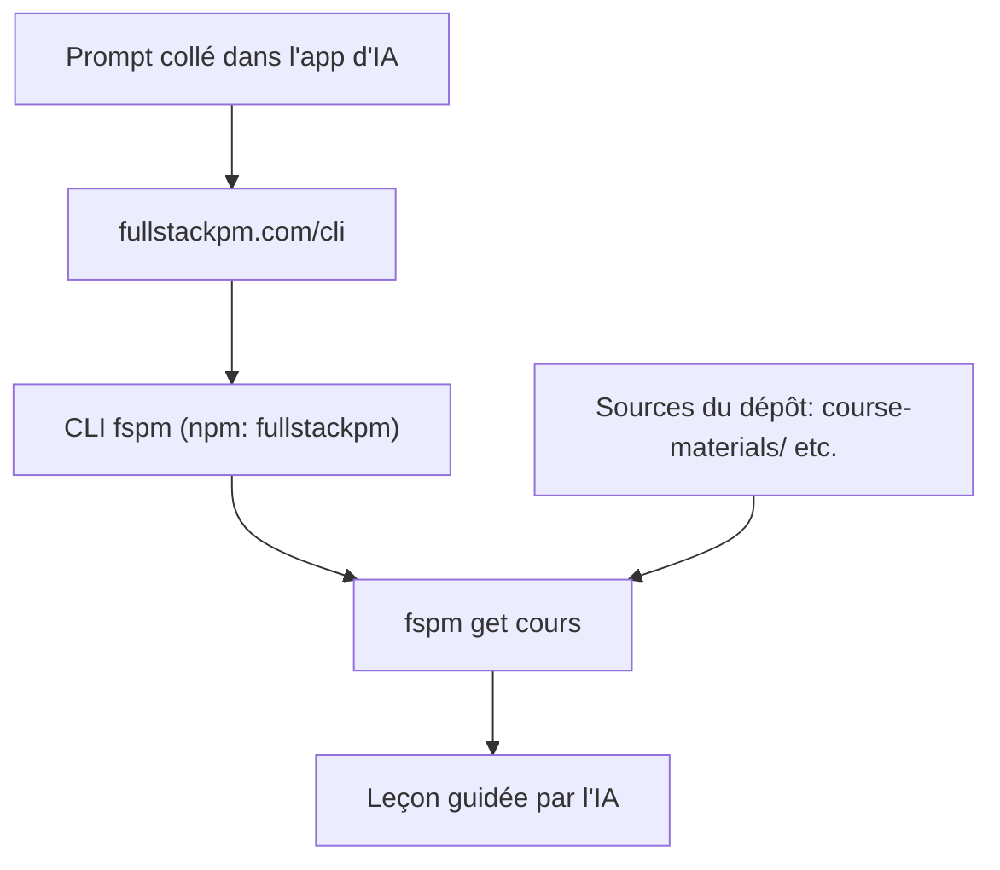

# carlvellotti/claude-code-pm-course

> Free, interactive courses to learn Claude Code, Cursor or Codex, aimed at product managers.

## The problem
Learning an AI tool through videos and slides remains passive. Product managers without a technical background do not know where to start.

## What it actually does
Each lesson runs inside your AI application (Claude, Cursor, Codex), with the AI acting as a guide. A paste-in prompt installs the Full Stack PM application, which lists the courses. The repository contains the course sources, "Short Stacks" mini-courses and bonuses.

## How it is wired
Simplified diagram based on the sheet, no diagram provided.



## Trying it
```bash
npm i -g fullstackpm
fspm onboard
fspm get claude-code-for-pms
```

## Cost and gotchas
The courses are free, but you need an AI application (Claude, Cursor or Codex) whose possible subscription remains at your expense. The content is relayed by fullstackpm.com; the paid "Full Stack Mastery" curriculum is promoted at the end of the README.

## What it is not
It is not a software tool: cloning the repository is not necessary to follow a course. It is not a data science or MLOps course, but an introduction to AI tools for product managers. The license is present but not identified by GitHub.

## Alternatives
No alternative named in the README.

## For you
Of little use for a data / AI / MLOps profile: the content targets beginner product managers; worth watching only if you train non-technical colleagues.
