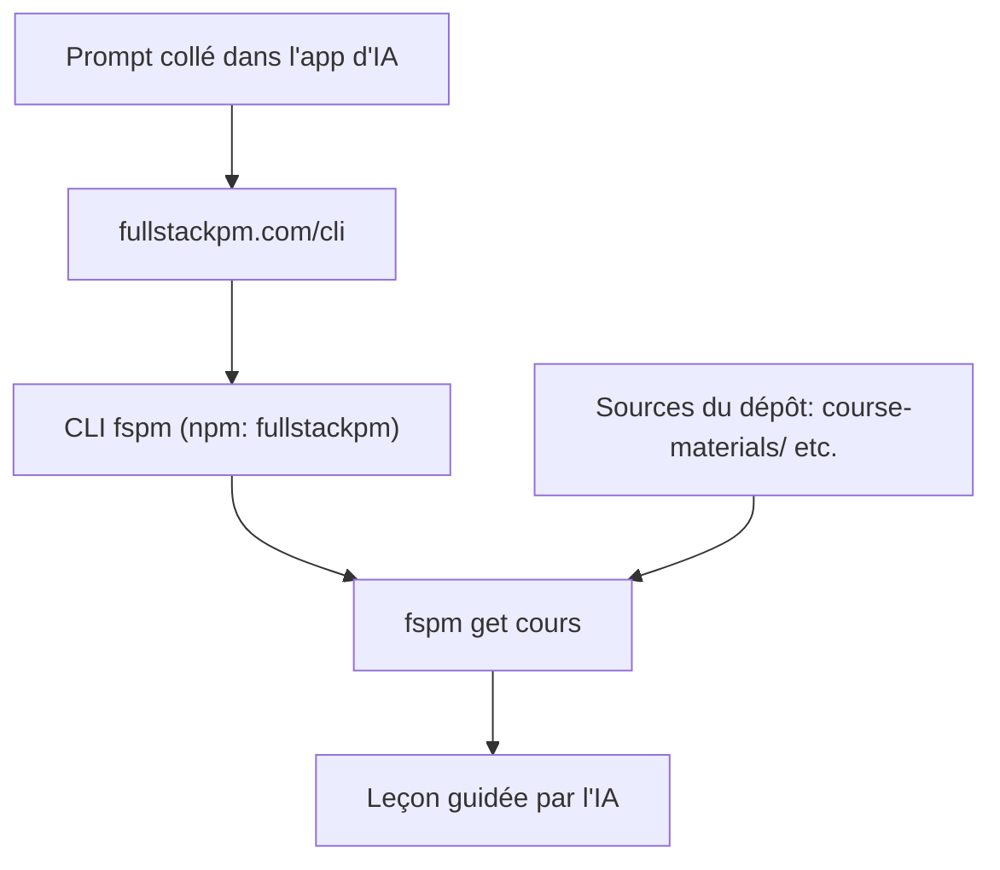

# carlvellotti/claude-code-pm-course

> Cours gratuits et interactifs pour apprendre Claude Code, Cursor ou Codex, destinés aux product managers.

## Le problème
Apprendre un outil d'IA par des vidéos et des slides reste passif. Les product managers sans bagage technique ne savent pas par où commencer.

## Ce que ça fait vraiment
Chaque leçon se déroule dans ton application d'IA (Claude, Cursor, Codex), l'IA servant de guide. Un prompt à coller installe l'application Full Stack PM, qui liste les cours. Le dépôt contient les sources des cours, des mini-cours « Short Stacks » et les bonus.

## Comment c'est branché
Schéma simplifié d'après la fiche, sans diagramme fourni.



## Essayer
```bash
npm i -g fullstackpm
fspm onboard
fspm get claude-code-for-pms
```

## Coût et pièges
Les cours sont gratuits, mais il faut une application d'IA (Claude, Cursor ou Codex) dont l'abonnement éventuel reste à ta charge. Le contenu est relayé par fullstackpm.com ; le cursus payant « Full Stack Mastery » est promu en fin de README.

## Ce que ce n'est pas
Ce n'est pas un outil logiciel : cloner le dépôt n'est pas nécessaire pour suivre un cours. Ce n'est pas un cours de data science ni de MLOps, mais de prise en main d'outils d'IA pour product managers. La licence est présente mais non identifiée par GitHub.

## Alternatives
Aucune alternative nommée dans le README.

## Pour toi
Peu utile pour un profil data / IA / MLOps : le contenu vise des product managers débutants ; à surveiller seulement si tu formes des collègues non techniques.

