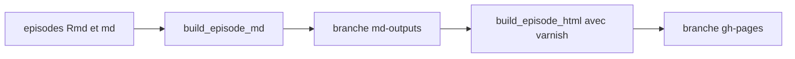

# carpentries/sandpaper

> R package that generates Carpentries lesson sites from Markdown or RMarkdown files.

## The problem
Carpentries lessons relied on Jekyll; content and style were hard to separate there.

## What it actually does
Turns Markdown or RMarkdown files into a styled static site. It validates the lesson structure and caches the rendering. It can produce a portable offline site. On GitHub, two branches (`md-outputs` then `gh-pages`) serve as the publishing chain.

## How it is wired
Simplified diagram based on the sheet, no diagram provided.



## Trying it
```r
options(repos = c(
  carpentries = "https://carpentries.r-universe.dev/",
  CRAN = "https://cran.rstudio.com/"
))
install.packages("sandpaper", dep = TRUE)
sandpaper::create_lesson("~/Desktop/r-intermediate-penguins")
sandpaper::build_lesson()
```

## Cost and gotchas
Free, but it requires R (and in practice RStudio); installation is outside CRAN. A license is present but not identified by GitHub. The README badge announces an "experimental" life cycle.

## What it is not
Not a general-purpose documentation tool: it targets the Carpentries lesson format. No lesson versioning (box not checked).

## Alternatives
The README mentions Jekyll (the old system) and {pkgdown} (used internally), without offering them as replacements.

## For you
Ignore: only of interest if you write training materials in R for the Carpentries.
