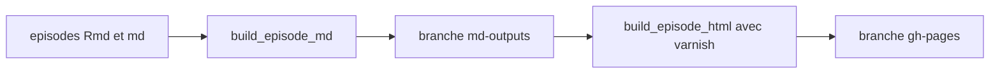

# carpentries/sandpaper

> Paquet R qui génère des sites de leçons Carpentries à partir de fichiers Markdown ou RMarkdown.

## Le problème
Les leçons de la Carpentries reposaient sur Jekyll ; le contenu et le style y étaient difficiles à séparer.

## Ce que ça fait vraiment
Transforme des fichiers Markdown ou RMarkdown en site statique stylé. Il valide la structure de la leçon et met en cache le rendu. Il peut produire un site portable hors ligne. Sur GitHub, deux branches (`md-outputs` puis `gh-pages`) servent de chaîne de publication.

## Comment c'est branché
Schéma simplifié d'après la fiche, sans diagramme fourni.



## Essayer
```r
options(repos = c(
  carpentries = "https://carpentries.r-universe.dev/",
  CRAN = "https://cran.rstudio.com/"
))
install.packages("sandpaper", dep = TRUE)
sandpaper::create_lesson("~/Desktop/r-intermediate-penguins")
sandpaper::build_lesson()
```

## Coût et pièges
Gratuit, mais il faut R (et RStudio en pratique) ; installation hors CRAN. La licence est présente mais non identifiée par GitHub. Le badge du README annonce un cycle de vie « experimental ».

## Ce que ce n'est pas
Pas un outil de documentation généraliste : il vise le format des leçons Carpentries. Pas de versionnage de leçons (case non cochée).

## Alternatives
Le README cite Jekyll (ancien système) et {pkgdown} (utilisé en interne), sans les proposer comme remplaçants.

## Pour toi
À ignorer : seul intérêt si tu écris des supports de formation en R pour la Carpentries.

