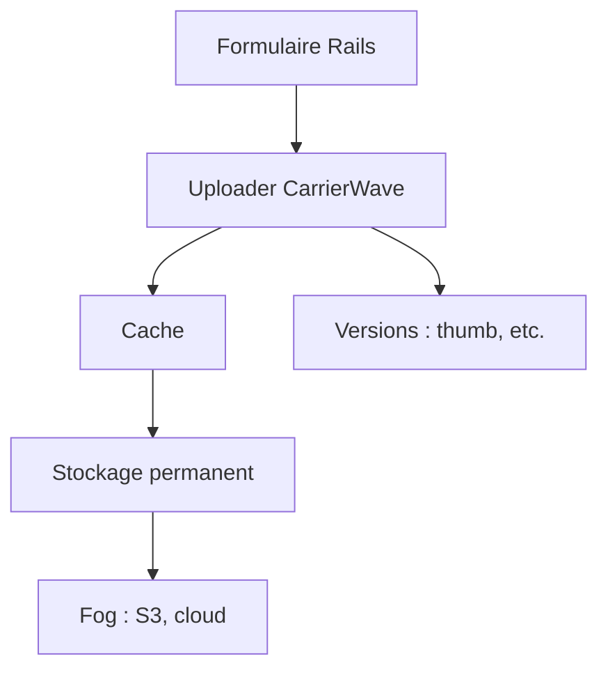

# carrierwaveuploader/carrierwave

> Ruby gem for uploading files in Rack or Rails applications, with local or cloud storage.

## The problem
Handling file uploads, their thumbnails, their storage and their validation by hand in a Rails application is repetitive and risky.

## What it actually does
You define an "uploader" class, mounted on a model column (`mount_uploader`). It handles a temporary cache and permanent storage, with image versions (thumbnails), conditional processing, allowlists of extensions or content types, and upload from a URL. Storage can be disk or cloud, notably S3 via Fog.

## How it is wired
Simplified diagram based on the sheet, no diagram provided.



## Trying it
```bash
gem install carrierwave
rails generate uploader Avatar
rails g migration add_avatar_to_users avatar:string
rails db:migrate
```

## Cost and gotchas
Free. Ruby required (not in the list of possible prerequisites). The README insists on an allowlist of content types to mitigate the ImageTragick vulnerability, and on disabling ImageMagick's SVG delegate. The license is not declared in the catalog.

## What it is not
It is not a storage service: it only drives one. Moving to version 3.0 changes how extensions are handled during format conversions.

## Alternatives
No alternative named in the README.

## For you
Ignore: Ruby gem for web applications, outside your scope, and with no declared license.
