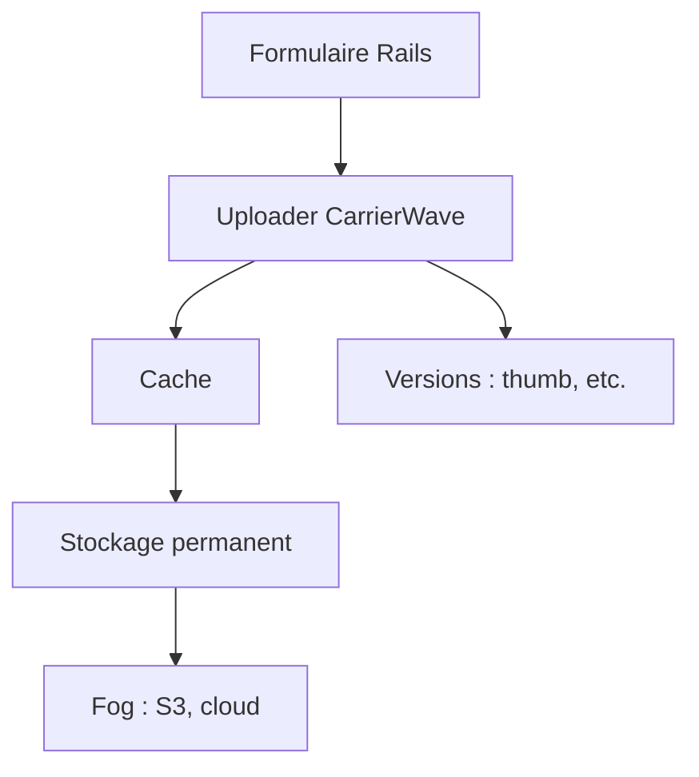

# carrierwaveuploader/carrierwave

> Gem Ruby pour téléverser des fichiers dans des applications Rack ou Rails, avec stockage local ou cloud.

## Le problème
Gérer les envois de fichiers, leurs miniatures, leur stockage et leur validation à la main dans une application Rails est répétitif et risqué.

## Ce que ça fait vraiment
On définit une classe « uploader », montée sur une colonne de modèle (`mount_uploader`). Elle gère un cache temporaire et un stockage permanent, avec versions d'image (miniatures), traitements conditionnels, listes autorisées d'extensions ou de types de contenu, et téléversement depuis une URL. Le stockage peut être le disque ou le cloud, notamment S3 via Fog.

## Comment c'est branché
Schéma simplifié d'après la fiche, sans diagramme fourni.



## Essayer
```bash
gem install carrierwave
rails generate uploader Avatar
rails g migration add_avatar_to_users avatar:string
rails db:migrate
```

## Coût et pièges
Gratuit. Ruby requis (pas dans la liste des prérequis possibles). Le README insiste sur une liste autorisée de types de contenu pour atténuer la faille ImageTragick, et sur la désactivation du délégué SVG d'ImageMagick. La licence n'est pas déclarée dans le catalogue.

## Ce que ce n'est pas
Ce n'est pas un service de stockage : il le pilote seulement. Le passage à la version 3.0 change la gestion des extensions lors des conversions de format.

## Alternatives
Aucune alternative nommée dans le README.

## Pour toi
À ignorer : gem Ruby pour des applications web, hors de ton périmètre, et sans licence déclarée.

