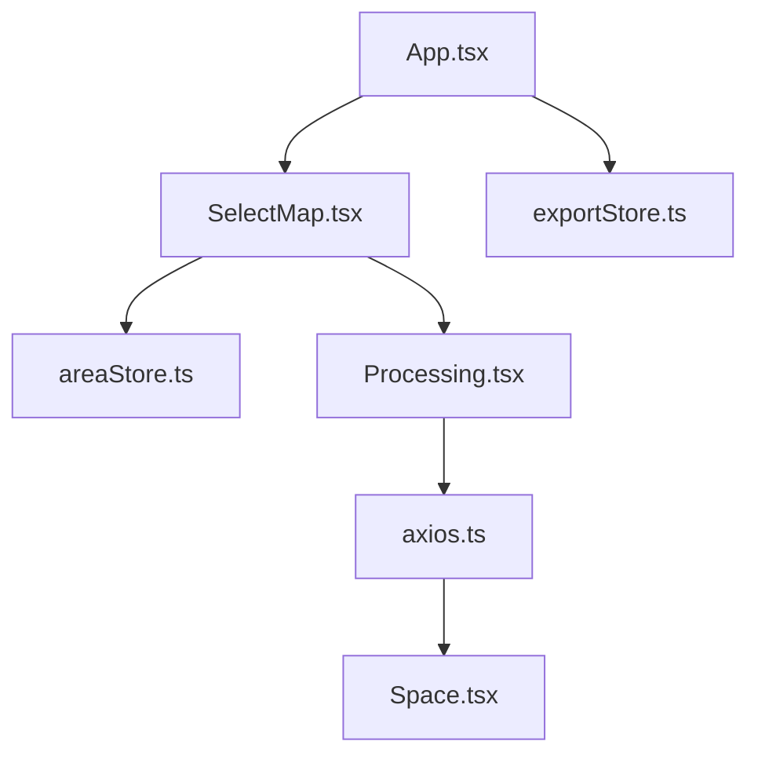

# cartesiancs/map3d

> Web service that generates a 3D map of buildings from OpenStreetMap and exports it as GLB.

## The problem
Producing a 3D model of a neighborhood from map data normally requires heavy GIS and 3D tools.

## What it actually does
Single-page application in React, TypeScript and Vite: you pick an area, it fetches OpenStreetMap data over HTTP, renders it with React Three Fiber and exports the scene as GLB. Building heights may be missing or wrong.

## How it is wired

## Trying it
No command in the README; only a demo video is given.

## Cost and gotchas
Free. The README describes neither installation nor a data server: the code shows no backend, and data access remains to be clarified.

## What it is not
Not a product with guaranteed accuracy: the README admits it. Not a turnkey drone or digital-twin tool, only a base.

## Alternatives
No alternative named in the README.

## For you
Watch: fun for geospatial or 3D visualization, but too young and poorly documented for production use.
