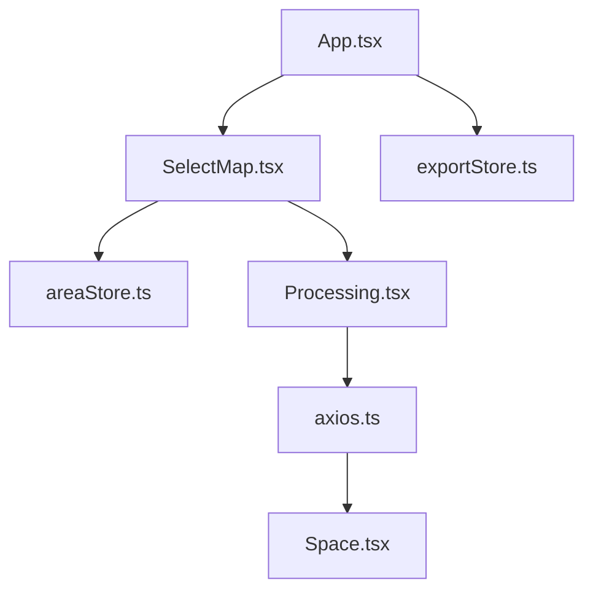

# cartesiancs/map3d

> Service web qui génère une carte 3D de bâtiments depuis OpenStreetMap et l'exporte en GLB.

## Le problème
Produire un modèle 3D d'un quartier à partir de données cartographiques demande normalement des outils SIG et 3D lourds.

## Ce que ça fait vraiment
Application monopage React, TypeScript et Vite : on choisit une zone, elle récupère les données OpenStreetMap par HTTP, les rend avec React Three Fiber et exporte la scène en GLB. Les hauteurs de bâtiments peuvent manquer ou être fausses.

## Comment c'est branché

## Essayer
Aucune commande dans le README ; seule une vidéo de démonstration est donnée.

## Coût et pièges
Gratuit. Le README ne décrit ni installation ni serveur de données : le code ne montre pas de backend, l'accès aux données reste à clarifier.

## Ce que ce n'est pas
Pas un produit à l'exactitude garantie : le README l'avoue. Pas un outil de drone ou de jumeau numérique clé en main, seulement une base.

## Alternatives
Aucune alternative nommée dans le README.

## Pour toi
Surveiller : amusant pour du géospatial ou de la visualisation 3D, trop jeune et peu documenté pour un usage de production.

