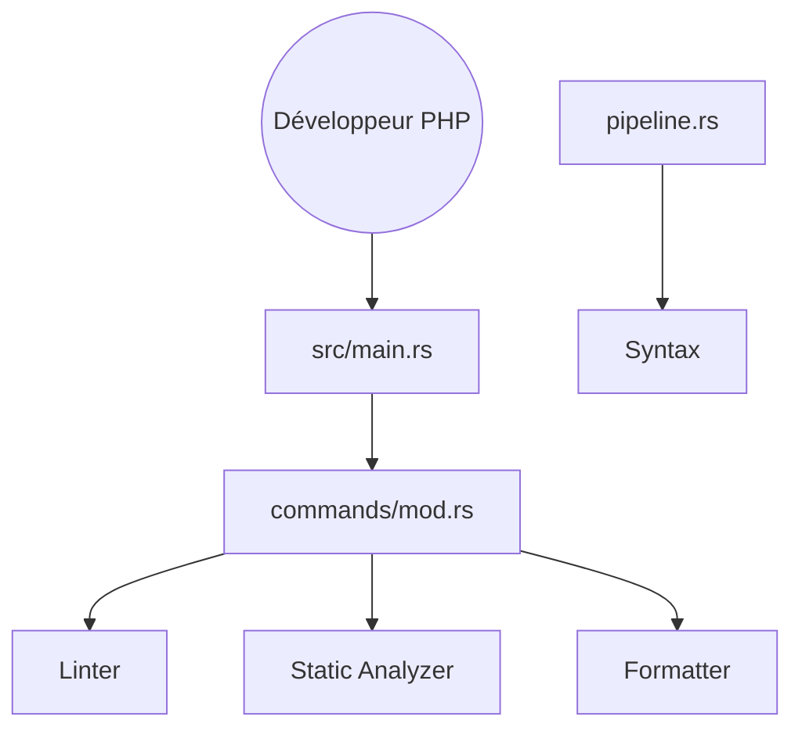

# carthage-software/mago

> PHP toolchain written in Rust: linter, formatter and static analyzer, very fast.

## The problem
PHP analysis and style tools are slow on large projects.

## What it actually does
- Commands `lint`, `analyze`, `format`, `guard` and syntax tree display.
- Automatic fixes for many lint issues.
- Parallel pipeline: code indexing, per-file analysis, reduction.
- TOML baselines and an extension SDK via Composer.

## How it is wired


## Trying it
```bash
curl --proto '=https' --tlsv1.2 -sSf https://carthage.software/mago.sh | bash
curl --proto '=https' --tlsv1.2 -sSf https://carthage.software/mago.sh | bash -s -- --version=1.59.0
```

## Cost and gotchas
Free. The install script is run directly from the web. Other modes: Homebrew, Composer, Cargo.

## What it is not
Not a PHP runtime nor a testing tool. The wiring of commands to the pipeline was not established in the code read.

## Alternatives
No alternative named in the README (Clippy, OXC and Hakana are cited as inspirations).

## For you
Ignore unless you maintain PHP: no benefit for your daily data / AI work.
