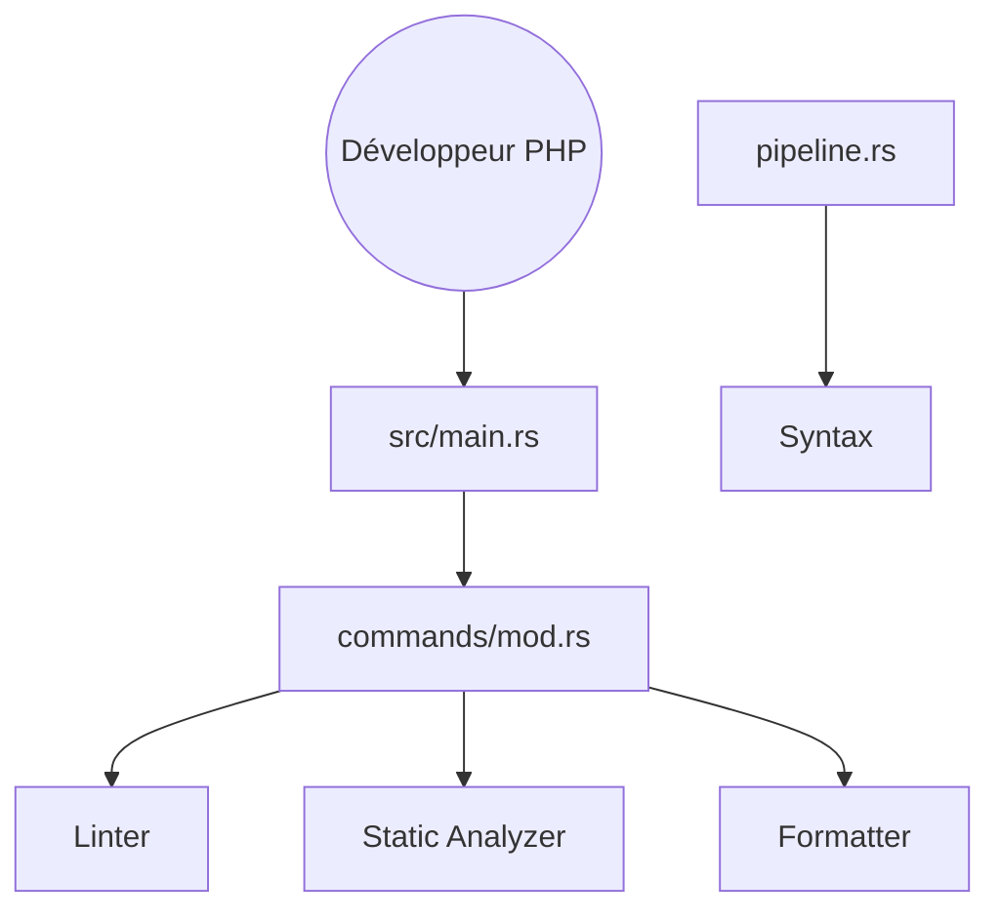

# carthage-software/mago

> Chaîne d'outils PHP écrite en Rust : linter, formateur et analyseur statique, très rapide.

## Le problème
Les outils PHP d'analyse et de style sont lents sur de gros projets.

## Ce que ça fait vraiment
- Commandes `lint`, `analyze`, `format`, `guard` et affichage de l'arbre syntaxique.
- Correctifs automatiques pour de nombreux problèmes de lint.
- Pipeline parallèle : indexation du code, analyse par fichier, réduction.
- Baselines TOML et SDK d'extensions via Composer.

## Comment c'est branché


## Essayer
```bash
curl --proto '=https' --tlsv1.2 -sSf https://carthage.software/mago.sh | bash
curl --proto '=https' --tlsv1.2 -sSf https://carthage.software/mago.sh | bash -s -- --version=1.59.0
```

## Coût et pièges
Gratuit. Le script d'installation est exécuté directement depuis le web. Autres modes : Homebrew, Composer, Cargo.

## Ce que ce n'est pas
Pas un exécuteur PHP ni un outil de tests. Le câblage des commandes vers le pipeline n'a pas été établi dans le code lu.

## Alternatives
Aucune alternative nommée dans le README (Clippy, OXC et Hakana sont cités comme inspirations).

## Pour toi
À ignorer sauf si tu maintiens du PHP : aucun apport pour ton quotidien data / IA.

