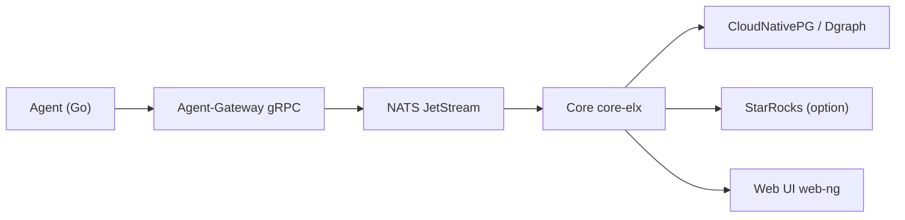

# carverauto/serviceradar

> Distributed network monitoring platform, with edge agents, WASM plugins and alerts.

## The problem
Monitoring isolated or network-constrained sites calls for lightweight agents, varied telemetry ingestion and alerts even during outages.

## What it actually does
Go agent on the hosts, gRPC gateway, Elixir/Phoenix/Ash core (orchestration, Oban), LiveView interface, NATS JetStream for ingestion. Storage: CloudNativePG (PostgreSQL) and Dgraph for topology, optional StarRocks for telemetry. Isolated WASM plugins, anomaly engine, causal engine, SRQL queries, React dashboards, SNMP, NetFlow, OTel, Ansible. Cosign-signed images.

## How it is wired


## Trying it
```bash
git clone https://github.com/carverauto/serviceradar.git
cd serviceradar
docker compose pull
docker compose up nats-creds-init
docker compose up -d
docker compose logs config-updater
```

## Cost and gotchas
Wide stack (NATS, PostgreSQL, Dgraph, StarRocks for NetFlow). Helm chart on a dedicated Harbor registry. The README mentions a demo site with public credentials. 336 open issues.

## What it is not
Not an ML model observability tool: it is network infrastructure monitoring. The "from the code" architecture (Next.js, Proton) differs from the current README (Elixir/StarRocks).

## Alternatives
- Nagios, Zabbix, SolarWinds: compared in the README.

## For you
Worth watching if you operate edge or remote sites; otherwise ML observability goes through other tools, and the stack is heavy.
