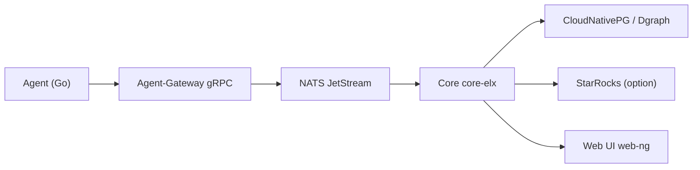

# carverauto/serviceradar

> Plateforme de supervision réseau distribuée, avec agents en bordure, plugins WASM et alertes.

## Le problème
Superviser des sites isolés ou contraints en réseau demande des agents légers, une ingestion de télémétrie variée et des alertes même en cas de coupure.

## Ce que ça fait vraiment
Agent Go sur les hôtes, passerelle gRPC, cœur Elixir/Phoenix/Ash (orchestration, Oban), interface LiveView, NATS JetStream pour l'ingestion. Stockage : CloudNativePG (PostgreSQL) et Dgraph pour la topologie, StarRocks optionnel pour la télémétrie. Plugins WASM isolés, moteur d'anomalies, moteur causal, requêtes SRQL, tableaux de bord React, SNMP, NetFlow, OTel, Ansible. Images signées Cosign.

## Comment c'est branché


## Essayer
```bash
git clone https://github.com/carverauto/serviceradar.git
cd serviceradar
docker compose pull
docker compose up nats-creds-init
docker compose up -d
docker compose logs config-updater
```

## Coût et pièges
Pile large (NATS, PostgreSQL, Dgraph, StarRocks pour NetFlow). Helm chart sur un registre Harbor dédié. Le README mentionne un site de démo avec identifiants publics. 336 issues ouvertes.

## Ce que ce n'est pas
Pas un outil d'observabilité de modèles ML : une supervision d'infrastructure réseau. L'architecture « d'après le code » (Next.js, Proton) diffère du README actuel (Elixir/StarRocks).

## Alternatives
- Nagios, Zabbix, SolarWinds : comparés dans le README.

## Pour toi
À surveiller si tu opères du edge ou des sites distants ; sinon l'observabilité ML passe par d'autres outils, et la pile est lourde.

