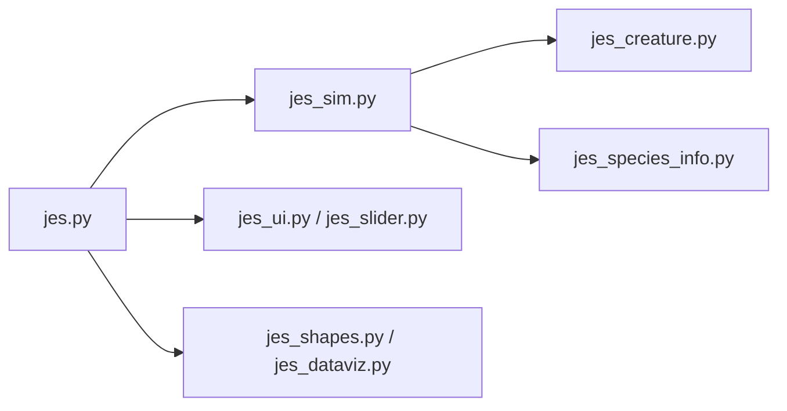

# carykh/jes

> Python simulator of evolving jelly creatures, for watching and exploring evolution generation by generation.

## The problem
Watching artificial evolution at work requires being able to go back in time and compare species, not just see the latest state.

## What it actually does
Desktop application launched by `jes.py`: `jes_sim.py` advances the generations, `jes_creature.py` and `jes_species_info.py` handle creatures and species. A timeline lets you browse the history, store a species in memory (S), recolor (C) and open a mosaic of the creatures (Q).

## How it is wired


## Trying it
```bash
cmd python jes.py
```

## Cost and gotchas
Free, dependencies in `requirements.txt`. No license: reuse rights are undefined.

## What it is not
Not a product: the author states no bug fixes and no support. Not a research tool for evolutionary algorithms; it is an experiment made for a video.

## Alternatives
None named in the README.

## For you
Ignore: with no license and no maintenance, it is a popularization toy; worth watching for intuition, not for integrating.
