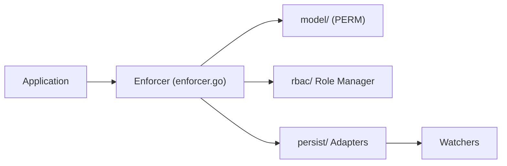

# casbin/casbin

> Go access-control library that applies ACL, RBAC or ABAC described in a model file.

Note: README identical to `apache/casbin` (same creation, neighboring issues); the two entries most likely designate the same project, renamed.

## The problem
Coding authorization rules yourself makes them rigid; switching models (ACL, RBAC, ABAC) forces you to rewrite code.

## What it actually does
The access model is described in a `.conf` file following the PERM metamodel (Policy, Effect, Request, Matchers); the rules live in a file or a database. `Enforce(sub, obj, act)` returns allowed or denied. The library also handles hierarchical roles, a superuser, operators such as `keyMatch`, persistence via adapters and synchronization across nodes via watchers.

## How it is wired


## Trying it
```bash
go get github.com/casbin/casbin/v3
```
The README then shows `casbin.NewEnforcer("path/to/model.conf", "path/to/policy.csv")` and `e.Enforce(sub, obj, act)` in Go.

## Cost and gotchas
Free, Apache-2.0. With the `in` operator in ABAC, the array must have more than one element, otherwise it panics (README warning). Go edition only for this operator.

## What it is not
No authentication: it checks neither credentials nor passwords and does not manage the user list.

## Alternatives
No alternative cited in the README.

## For you
Watch: interesting if your model API is in Go and must handle role-based permissions; without Go, this is not your tool.
