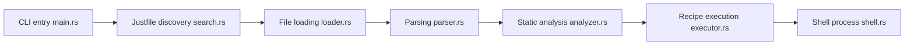

# casey/just

> Project command runner: you write recipes in a `justfile`, and run them with `just`.

## The problem
Test, build and deployment commands live in shell history or in an ill-suited Makefile.

## What it actually does
Reads a `justfile` (syntax close to `make`), with parameters, dependencies, variables, `.env` files, modules and imports, and recipes written in Python or Node. Static errors are reported before execution, with shell completion, `--list`, `--fmt`. Not a build tool: all recipes are "phony".

## How it is wired


## Trying it
```bash
cargo install just
just --version
just --list
just test
```

## Cost and gotchas
Free. On Windows, you need an `sh` or have to set `set shell`. Several functions remain unstable (`set unstable`).

## What it is not
Not a build system with file tracking (the recipe cache is unstable and fragile). The project no longer accepts pull requests; CC0.

## Alternatives
make (the ancestor of just), task (YAML), mise (tasks in TOML, also a tool manager).

## For you
Adopt: a `justfile` documents the commands of an ML project (training, tests, deployment) in one readable file, with no dependency.
