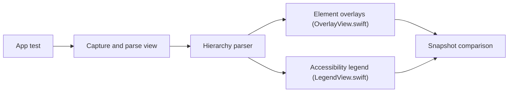

# cashapp/AccessibilitySnapshot

> Accessibility regression testing library for iOS applications, using snapshots of the accessibility hierarchy.

## The problem
A UI change can break accessibility without anyone noticing.

## What it actually does
Captures a view, parses its accessibility hierarchy and produces an annotated image (markers, legend, activation points) compared against a reference. Relies on SnapshotTesting by default, or iOSSnapshotTestCase. Also supports keyboards and touch areas.

## How it is wired


## Trying it
```bash
# Package.swift : .package(name: "AccessibilitySnapshot", url: "https://github.com/cashapp/AccessibilitySnapshot.git", from: "0.4.1")
# Test : assertSnapshot(matching: view, as: .accessibilityImage)
```

## Cost and gotchas
Free. Xcode 13.2.1+, iOS 13+, test target with a host application.

## What it is not
Not an automatic audit: it compares images against a recorded reference and does not judge compliance.

## Alternatives
Based on SnapshotTesting or iOSSnapshotTestCase; PlaybookAccessibilitySnapshot extension for Playbook.

## For you
Ignore: iOS application testing, unrelated to data, AI or MLOps.
