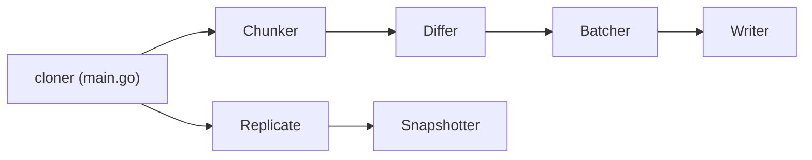

# cashapp/cloner

> Go application that clones and replicates one MySQL database to another without stopping writes.

## The problem
Copying or verifying a large live MySQL database without freezing replication is slow and risks losing consistency.

## What it actually does
Splits tables into chunks, compares source and target, groups the differences (insert, update, delete) and writes them in parallel. It also reads the MySQL binlog to replicate with resume points, checks checksums per chunk, measures end-to-end lag (Prometheus metric) and offers a consistent clone following Netflix's DBLog algorithm. DDL is not handled during replication.

## How it is wired


## Trying it
```bash
# Aucune commande documentée dans le README : voir le tutoriel du dépôt.
```

## Cost and gotchas
The consistent clone requires write access to the source (watermark table). Last push in March 2024: little maintenance. MySQL only.

## What it is not
Not a schema migration tool: no DDL during replication. Not suited to PostgreSQL or non-MySQL databases.

## Alternatives
No alternative named in the README; it cites the DBLog paper (Netflix) as the algorithm.

## For you
Keep an eye on it: useful if you need to copy live MySQL databases to a lake or warehouse, but inactive since 2024; test it before relying on it.
