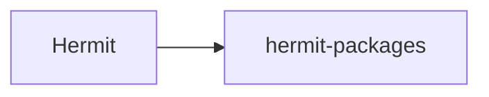

# cashapp/hermit-packages

> Package repository for Hermit, Cash App's environment manager; empty README.

## The problem
Not documented: the README is empty.

## What it actually does
Not documented. The README is empty; nothing can be claimed beyond the repository name.

## How it is wired

Not documented: minimal diagram inferred from the name.

## Trying it
No documented command.

## Cost and gotchas
Not documented. License present but not identified by GitHub.

## What it is not
Not a documented project: impossible to judge without the code.

## Alternatives
No alternative named in the README.

## For you
Ignore: empty README, so nothing verifiable for you.
