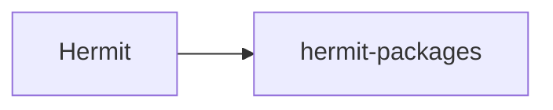

# cashapp/hermit-packages

> Dépôt de paquets pour Hermit, le gestionnaire d'environnements de Cash App ; README vide.

## Le problème
Non documenté : le README est vide.

## Ce que ça fait vraiment
Non documenté. Le README est vide ; on ne peut rien affirmer au-delà du nom du dépôt.

## Comment c'est branché

Non documenté : schéma minimal déduit du nom.

## Essayer
Aucune commande documentée.

## Coût et pièges
Non documenté. Licence présente mais non identifiée par GitHub.

## Ce que ce n'est pas
Pas un projet documenté : impossible de juger sans le code.

## Alternatives
Aucune alternative nommée dans le README.

## Pour toi
À ignorer : README vide, donc rien de vérifiable pour toi.

