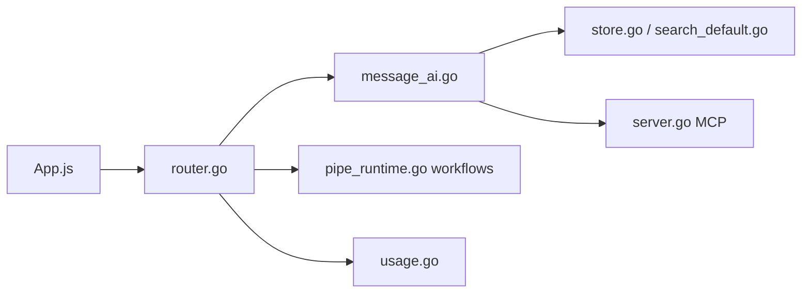

# casibase/casibase

> Self-hostable personal AI assistant (LLM, RAG, agents), shipped as a single binary; the README calls it OpenAgent.

## The problem
Bringing together several model providers, a knowledge base and tool-equipped agents in a platform you host yourself.

## What it actually does
Web interface to chat with more than 30 LLM providers, a RAG (ingestion of PDF, Word, Excel, chunking, embeddings, semantic search), agents (browser, shell, Office, web search, MCP) and a BPMN workflow editor with scheduled tasks. Adds SSO (OIDC, OAuth2, LDAP, SAML), multi-tenancy, audit logs and per-model usage tracking.

## How it is wired


## Trying it
```bash
curl -fsSL https://raw.githubusercontent.com/the-open-agent/openagent/master/scripts/install.sh | bash
docker-compose up
```
Then open http://localhost:14000.

## Cost and gotchas
Free, but calls to model providers remain at your expense. The README uses `curl | bash` and points to another repository (the-open-agent/openagent): the name of the analyzed repository does not match the product's. Build from source: Go 1.25+, Node 20+, Yarn.

## What it is not
Not an agent framework for developers: it is a complete application, with its own interface and authentication choices.

## Alternatives
No alternative cited in the README.

## For you
Worth watching: handy as a multi-model RAG and MCP test bench, but the name mismatch with the repository calls for verifying the origin before installing.
